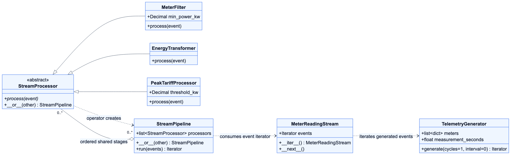

# AI-Powered Smart Energy Management System

**Group 25**

**Hometask 2 — Real-Time Data Processing**

This is our Capstone project for the Compact Programming course at FH Dortmund. Our goal is to monitor energy use in buildings and process smart-meter data for analysis and sustainability recommendations.

## Hometask 2 Implementation

I am **Rifat Ali Shaon — 7225871 (MDT)**. I implemented Hometask 2 independently, as permitted by our professor. This assignment contains seven classes that generate, filter and transform simulated energy events in Python.

The simulation includes HVAC meters, solar inverters and batteries. Each event is processed as it arrives. The program does not wait for the complete stream before producing results.

Our Capstone group members are:

| Member | Student ID | Program |
|---|---|---|
| Syed Yasoob Raza | 7226703 | ESE |
| Rifat Ali Shaon | 7225871 | MDT |
| Marwan Ahmed | 7226233 | MDT |

## Required Python Concepts

| Concept | How it is demonstrated |
|---|---|
| Abstract base classes | `StreamProcessor` inherits from `ABC` and declares `process(event)` with `@abstractmethod`. |
| Inheritance and polymorphism | The three specialized processors inherit from `StreamProcessor`. The pipeline calls the same `process(event)` method on each stage. |
| Operator overloading | `__or__()` connects processors and pipelines using `|`. Each composition creates a new pipeline. |
| Iterators and generators | `MeterReadingStream` implements `__iter__()` and `__next__()`. Both `generate()` and `run()` use `yield` to produce one event at a time. |

## The Seven Classes

| Class | Responsibility |
|---|---|
| `TelemetryGenerator` | Generates simulated readings over a chosen number of cycles. Calculates energy from power and measurement duration. Adds a charging or discharging mode to battery events. |
| `MeterReadingStream` | Wraps an iterable and returns the next event on demand. It raises `StopIteration` when exhausted. |
| `StreamProcessor` | Defines the common abstract `process(event)` interface and starts pipeline composition with `|`. |
| `MeterFilter` | Keeps active readings whose power is at or above `min_power_kw`. Returns `None` for rejected readings. |
| `EnergyTransformer` | Adds `net_grid_contribution_kwh`, the signed energy contribution of this event. |
| `PeakTariffProcessor` | Adds a Boolean `is_peak` flag to consumption events strictly above `threshold_kw`. It does not calculate prices or bills. |
| `StreamPipeline` | Runs its stages in order, skips rejected events and yields accepted results incrementally. |

## Streaming Pipeline

```text
TelemetryGenerator.generate()
        |
        v
MeterReadingStream
        |
        v
MeterFilter
        |
        v
EnergyTransformer
        |
        v
PeakTariffProcessor
        |
        v
Processed events -> terminal output
```

For example:

```python
from backend.streaming.source import MeterReadingStream, TelemetryGenerator
from backend.streaming.processors import MeterFilter, EnergyTransformer, PeakTariffProcessor

meters = [
    {"meter_id": 1, "category": "HVAC", "is_active": True},
    {"meter_id": 2, "category": "SOLAR", "is_active": True},
    {"meter_id": 3, "category": "BATTERY", "is_active": True,
     "battery_mode": "DISCHARGING"}
]

pipeline = (
    MeterFilter(min_power_kw=0.5)
    | EnergyTransformer()
    | PeakTariffProcessor(threshold_kw=4.0)
)

generator = TelemetryGenerator(meters, measurement_seconds=60)
stream = MeterReadingStream(generator.generate(cycles=5, interval=1))

for event in pipeline.run(stream):
    print(event)
```

`TelemetryGenerator` keeps a reusable list of meter definitions. The event generator and pipeline are not converted to lists. A rejected event stops at the filter, while later events continue through the pipeline. Invalid data raises a clear `TypeError` or `ValueError` and stops the run.

## Event Format and Energy Calculations

The original event fields are preserved. A generated HVAC event can look like this:

```python
{
    "meter_id": 1,
    "category": "HVAC",
    "is_active": True,
    "power_kw": 3.0,
    "consumption_kwh": 0.05,
    "measurement_seconds": 60.0,
    "timestamp": "2026-11-04T12:00:00+00:00"
}
```

Battery events also contain `battery_mode`, with the value `CHARGING` or `DISCHARGING`. A configured mode is preserved. If no mode is supplied, the generator chooses one for each reading.

Power and energy are nonnegative magnitudes. The existing `consumption_kwh` field represents measured energy for every category, including solar generation and battery flows.

```text
energy_kwh = power_kw * measurement_seconds / 3600
```

For example, 3 kW over 60 seconds is 0.05 kWh. `measurement_seconds` describes the measurement. `interval` only controls the simulation's wait between cycles. A one-second demo delay can therefore represent a 60-second energy measurement.

Source power and energy remain numeric floats for compatibility. Energy is calculated using `Decimal` before conversion to a float. `EnergyTransformer` adds a `Decimal` contribution, with these signs:

| Event | Net grid contribution |
|---|---|
| HVAC consumption | Positive |
| Solar generation | Negative |
| Battery charging | Positive |
| Battery discharging | Negative |

Thus, 2 kWh of HVAC consumption and 1 kWh of solar generation contribute 1 kWh together. Each processed event contains its own contribution, not a whole-building total. LIGHTING and PLUG events are also supported as positive consumption for later Capstone use.

Filtering uses `power_kw`, not energy. All categories use the same inclusive minimum-power threshold. Peak detection uses a strict `>` comparison and applies only to HVAC, LIGHTING, PLUG and charging batteries. Solar and discharging batteries are never marked as consumption peaks.

Processors check required fields, numeric values, UTC timestamps and battery modes. If duration metadata is present, energy must match power and duration within 0.000000001 kWh to allow small float conversion differences. Older events without duration metadata remain supported, but battery direction is required.

## UML Class Diagram



[Editable Mermaid source](docs/uml/hometask2-streaming.mmd)

The three processors inherit from the abstract interface. A pipeline holds an ordered collection of processors, which may be shared between pipelines. The dependencies show the generator output being consumed through the iterator and pipeline.

## Project Structure

```text
.gitignore
README.md

backend/
    streaming/
        __init__.py
        source.py
        processors.py
        demo.py
        tests/
            test_source.py
            test_processors.py

docs/
    uml/
        hometask2-streaming.mmd
        hometask2-streaming.png
```

This branch contains only the Hometask 2 streaming framework, tests and UML files. Hometask 1 code and its subsystem tests are maintained separately on `Homeworkassignment-01`.

## Run the Demonstration

Use Python 3.9 or later. No external packages are required. Run commands from the main project folder:

```bash
python3 -m backend.streaming.demo --cycles 3 --interval 1
```

For a short, repeatable demonstration:

```bash
python3 -m backend.streaming.demo --cycles 2 --interval 1 --seed 25
```

The five demo meters include HVAC, solar, a charging battery, a discharging battery and an inactive HVAC meter. Only accepted events are printed. The final line reports how many events were generated, accepted and filtered. The demonstration finishes automatically.

The following settings are available:

| Option | Default | Meaning |
|---|---|---|
| `--cycles` | `3` | Number of measurement cycles; zero is allowed. |
| `--interval` | `1` | Nonnegative seconds to wait between cycles. |
| `--measurement-seconds` | `60` | Positive duration represented by each reading. |
| `--min-power-kw` | `0.5` | Minimum accepted power. |
| `--peak-threshold-kw` | `4.0` | Consumption power must exceed this value to be marked peak. |
| `--seed` | Not set | Optional seed for repeatable simulated power values. |

Example output from the seeded two-cycle run follows. Timestamps change on each run:

```text
Measurement: 60s; wait between cycles: 1s
[10:32:23 UTC] meter=1 HVAC    -           1.88 kW energy=0.031333 kWh net contribution=+0.031333 kWh ACCEPTED
[10:32:23 UTC] meter=2 SOLAR   -           4.63 kW energy=0.077167 kWh net contribution=-0.077167 kWh ACCEPTED
[10:32:23 UTC] meter=3 BATTERY CHARGING    4.22 kW energy=0.070333 kWh net contribution=+0.070333 kWh PEAK
[10:32:23 UTC] meter=4 BATTERY DISCHARGING 1.07 kW energy=0.017833 kWh net contribution=-0.017833 kWh ACCEPTED
Generated 10; accepted 7; filtered 3.
```

Only the first cycle's event lines are shown above; the counts include both cycles. Displayed energy values are rounded to six decimal places, while processing uses the stored values.

The original raw-source demonstration is still available with `python3 -m backend.streaming.source`.

## Run the Unit Tests

```bash
python3 -m unittest discover -s backend/streaming/tests -v
```

The 43 tests cover the original source behaviour, abstract classes, inheritance, composition, iterator exhaustion, laziness, filtering, contribution signs, duration consistency, peak flags, validation and the terminal demo. Tests use fixed events, mocked power values or a fixed random seed.

The original source tests were retained. Their energy expectations now follow the physical formula instead of an unrelated random energy value. Each event uses one random power draw, so the corresponding call-count checks were updated. Duration and battery-mode checks were added.

## Five-Minute Solo Video Presentation

The presentation will explain the seven classes, show the `|` pipeline, run the live demonstration and show the unit-test results.

**Video link:** To be added before submission.

## Relationship to the Final Capstone

Version 4 is the architecture reference. This streaming framework will later contribute to S1 — Energy Monitoring & Data Management. The final Capstone plans to use Django REST Framework, PostgreSQL, Streamlit and OpenAI.

Hometask 2 uses only Python's built-in libraries. Simulated power values are illustrative, and batteries do not model state of charge or efficiency. Filtering can remove energy events, so accepted contributions alone should not be treated as a complete building balance. There is no billing calculation, persistent storage or cross-branch import into the Hometask 1 implementation.
