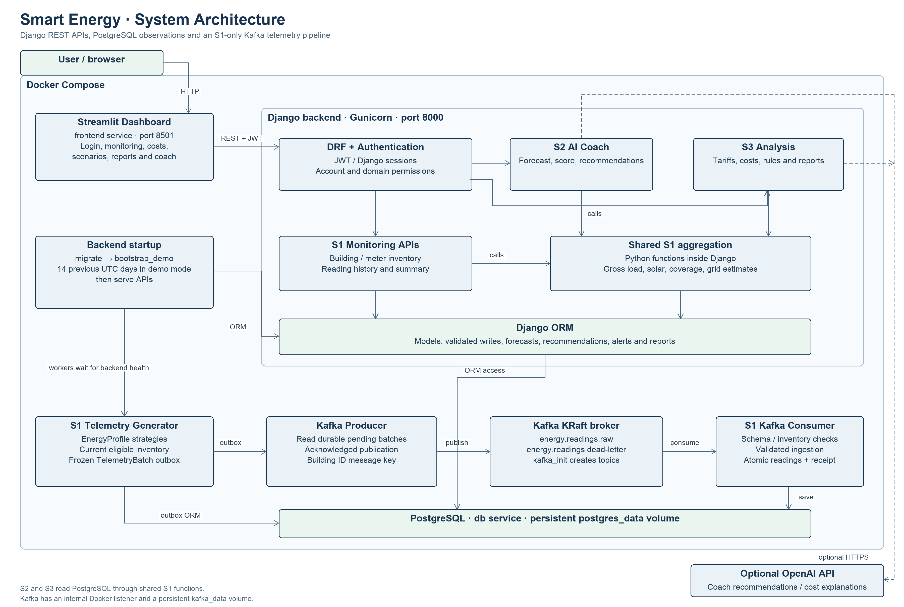

# AI-Powered Smart Energy Management System

Capstone project · Compact Programming · FH Dortmund · Group 25

Smart Energy helps a building's users inspect electricity use, understand tariff-based
costs and explore energy-saving actions. It combines energy monitoring, a sustainability
coach and cost/scenario analysis in a Streamlit dashboard backed by Django REST APIs.
**Current smart-meter readings are simulated.** The project provides a university
software demonstration using synthetic interval observations.

## Project Overview

S1 manages inventory and measurement quality. S2 uses complete historical days for
heuristic forecasts and energy-saving recommendations. S3 prices matched intervals,
evaluates what-if scenarios and stores alerts and reports. The shared S1 calculations
keep the measurement rules consistent across these subsystems.

## System Architecture



Docker Compose runs PostgreSQL, Django/Gunicorn, Streamlit, a KRaft Kafka broker,
topic initialization and separate telemetry producer/consumer processes. The backend
applies migrations and runs demo initialization before serving requests. Domain APIs
require authentication. Streamlit sends JWT bearer tokens to Django.

The S1 producer persists an outbox batch before Kafka publication. The consumer
validates and stores a complete building-minute in PostgreSQL. S1 APIs, S2 and S3
use stored observations through the Django ORM and shared Python aggregation.
Optional OpenAI calls support coach recommendations and cost explanations.

## Main Features

### S1 — Energy Monitoring & Data Management

- Create buildings, assign meters, activate or deactivate devices and inspect history.
- Generate deterministic minute telemetry with electricity, HVAC, lighting and solar strategies.
- Validate readings, reject duplicate/conflicting/overlapping data and process Kafka batches atomically.
- Initialize complete historical demo days and calculate gross consumption, solar and interval grid estimates.

### S2 — Sustainability Analysis & AI Coach

- Calculate and store seven daily heuristic forecasts from complete recent UTC days.
- Present an illustrative sustainability score, grade and carbon scenario.
- Generate rule-based or optional OpenAI energy recommendations with provider execution logs.
- Store authenticated recommendation ratings, acceptance flags and comments.

### S3 — Energy Costs, Scenarios & Alerts

- Manage global tariffs and estimate interval import charges, export credits and net cost.
- Compare consumption, solar and tariff scenarios over complete periods.
- Detect four rule-based alert types and track resolution.
- Generate stored cost reports, export displayed reports as CSV and explain cost figures.

## Technology Stack

| Technology | Role |
|---|---|
| Python 3.13 | Supplied Docker runtime and service implementation. |
| Django 5.2 / Django REST Framework | Models, migrations, validation and JSON APIs. |
| SimpleJWT / Django authentication | Token issuance, account profiles and authenticated endpoints. |
| PostgreSQL 18 | Persistent inventory, readings and subsystem records. |
| Apache Kafka 4.3.2 / Confluent Python client | S1 telemetry transport, replay and dead-letter handling. |
| Streamlit | Dashboard, forms, session state and navigation. |
| Pandas / NumPy | Dashboard charts and sampled-power alert rules. |
| Decimal | Currency arithmetic and cent rounding. |
| OpenAI Python SDK | Optional recommendation and cost-explanation requests. |
| Docker Compose / Gunicorn | Local service orchestration and API serving. |

## Subsystem Documentation

Each guide contains ten functional requirements, ten non-functional requirements,
implemented classes, data flow, APIs, validation, tests and limitations.

| Subsystem | Technical guide | UML PNG |
|---|---|---|
| S1 | [Energy monitoring](docs/subsystems/s1-energy-monitoring.md) | [Class diagram](docs/images/s1-class-diagram.png) |
| S2 | [Sustainability and AI coach](docs/subsystems/s2-sustainability-ai-coach.md) | [Class diagram](docs/images/s2-class-diagram.png) |
| S3 | [Costs, scenarios and alerts](docs/subsystems/s3-costs-scenarios-alerts.md) | [Class diagram](docs/images/s3-class-diagram.png) |

## Installation and Setup

### Prerequisites and configuration

Install Git and Docker Desktop with Docker Compose. Commands below run from the
repository root in Bash/zsh or Git Bash. The supplied services share a Python image.
Fresh setup requires available host ports 8000 and 8501 and internet access to pull
images and install declared dependencies.

```sh
git clone https://github.com/Techrifat97/AI-Powered-Smart-Energy-Management-System.git
cd AI-Powered-Smart-Energy-Management-System
cp -n .env.example .env
```

PowerShell can create the private file with
`if (!(Test-Path .env)) { Copy-Item .env.example .env }`.
Existing installations use their current private `.env` and matching database
credentials. The tracked example defines the actual variables consumed by Compose.

| Variable | Configuration |
|---|---|
| `SECRET_KEY`, `DB_PASSWORD` | Set private values before initializing a fresh database. |
| `DB_NAME`, `DB_USER` | PostgreSQL database and role created on an empty volume. |
| `DB_HOST`, `DB_PORT` | Host-development connection. Compose sets container values to `db` and `5432`. |
| `DB_TEST_NAME` | Disposable test database beginning with `test_`, distinct from the application database. |
| `BACKEND_PORT`, `FRONTEND_PORT` | Published host ports, defaulting to 8000 and 8501. |
| `DEMO_MODE` | `true` enables demo administrator, dedicated inventory and historical initialization. |
| `OPENAI_API_KEY`, `OPENAI_MODEL` | Optional AI configuration. An empty key selects rule-based behavior. |

The Compose file fixes the internal broker address, consumer group and frontend API
address. Some corresponding host-development variables in `.env.example` are
therefore overridden inside containers. Runtime settings load optional host `.env`
files with process variables taking precedence. Keep private files outside Git.

### Build and start

```sh
docker compose config --quiet
docker compose up -d --build
docker compose ps -a
docker compose logs --tail 30 backend telemetry consumer
```

PostgreSQL starts using `postgres_data`. Backend startup runs `migrate --noinput`,
then `bootstrap_demo`, then Gunicorn. Kafka initializes KRaft storage in `kafka_data`.
`kafka_init` creates `energy.readings.raw` and `energy.readings.dead-letter` and
should exit with code 0. Producer and consumer wait for backend health and topic
initialization. The frontend waits for backend health.

The existing setup has seven services. PostgreSQL, Kafka and backend have health
checks. Frontend and telemetry workers show running status. The public health
response checks HTTP responsiveness. Application/database failures require further
inspection of domain requests and service logs.

Open the dashboard at http://localhost:8501 and the API health route at
http://localhost:8000/api/health/. Individual protected API endpoints are listed in
the subsystem guides. `/api/` itself has no index route.

On a fresh demo, log in with username **admin** and password **admin123**. These
public evaluator credentials are hardcoded development defaults. An existing admin
uses its stored password. Demo initialization preserves that account. For a fresh
non-demo installation, an administrator can run
`docker compose exec backend python backend/manage.py createsuperuser`.

### Restart, stop and persistence

```sh
docker compose stop
docker compose up -d
docker compose down
```

Ordinary `down` retains the named database and Kafka volumes. The `-v` option deletes
those persistent volumes and should be reserved for an explicitly approved data reset.
Changing initialization passwords in `.env` does not rotate existing database
credentials. Private configuration must match the volume's established role.

After source changes, rebuild with `docker compose up -d --build`. The Docker image
copies application code at build time. Compose publishes backend/frontend ports on
all host interfaces by default. Review access before using a shared network.

### Optional host development

A host virtual environment can run the same code with a separately configured
PostgreSQL database. Install `requirements.txt`, configure the root `.env`, inspect
`python backend/manage.py migrate --plan`, then apply migrations to the intended
development database and run Django. A role with `CREATEDB` supports disposable tests.
The explicit `run_telemetry --mode direct` command writes through ingestion. Select
one telemetry pipeline for each database. The frontend can run separately with
`streamlit run frontend/app.py` and a suitable `SMART_ENERGY_API`.

## Application Usage

1. Log in and select a building in the sidebar. Labels include IDs so duplicate
   names remain distinguishable. Log out from the sidebar after the demonstration.
2. Open Overview for gross consumption, solar, estimated cost, open alerts and charts.
3. Use Building Management to create metadata, then Meter Management to add a main
   meter and any required solar meter. A new building begins without historical data.
4. Activate eligible meters and wait through two UTC minute boundaries. Deactivation
   preserves history. Required-meter deactivation asks for confirmation and pauses
   whole-building telemetry.
5. Open Forecast for seven predicted daily values. Generate Recommendations and
   expand the sustainability assessment. Saved tips accept ratings and comments.
6. On Costs, inspect the active tariff and charge/credit breakdown. Explain my costs
   uses OpenAI when configured and falls back to template text.
7. Open Scenarios, shown as “What if...?”, and choose an idea. Calculations update as
   controls change. More options accepts inclusive UTC dates. The default uses the
   latest contiguous complete days when available.
8. On Alerts, press Check for new alerts and resolve reviewed findings. Detection is
   user-triggered. Reports stores calculations for covered UTC dates and offers CSV.
9. Team Management lists accounts and exposes create/delete actions. Current API
   permissions allow any authenticated account to manage other ordinary accounts.

The account API exposes the authentication and team-management operations used by
the dashboard. Access tokens last 24 hours and refresh tokens last seven days.

| Route | Method | Request / response behavior |
|---|---|---|
| `/api/auth/token/` | POST | Username/password produce `access` and `refresh` tokens. |
| `/api/auth/token/refresh/` | POST | A refresh token produces an access token. |
| `/api/accounts/me/` | GET | Return the authenticated user's profile. |
| `/api/accounts/users/` | GET, POST | List or create accounts for authenticated callers. |
| `/api/accounts/users/{id}/` | GET, DELETE | Retrieve or remove another ordinary account, subject to self/admin guards. |

API clients send the access token as `Authorization: Bearer <token>`. Django session
authentication is also configured. The current frontend uses the access token and
returns to login after a domain 401.

## Demo Dataset

Fresh demo setup creates **Campus Sonnenstraße Dortmund**, with four reserved meters
`DO-SON-MAIN`, `DO-SON-HVAC`, `DO-SON-LIGHTING` and `DO-SON-SOLAR`. It creates 1,344
hourly readings across 14 complete previous UTC days. Main and solar intervals
match, including recorded night solar zeros. A flat import tariff and feed-in rate
are supplied when initial setup finds no active plan.

Live telemetry then generates completed 60-second intervals. Stored hourly durations
remain 3600 seconds. HVAC and lighting are included in the main gross load. Solar
records generation separately. Demo readings are reproducible synthetic profiles.

Stable dataset identity and reserved device IDs protect repeat initialization and
renamed inventory. Existing populated dedicated inventory is adopted without filling
gaps. Explicit demo-only `bootstrap_demo --refresh` fills wholly empty recent days
and skips partial or unresolved coverage. Normal startup never backfills downtime.
The legacy `seed_demo_data` command remains preserved for coursework fixtures.

## Testing

Run against a distinct disposable PostgreSQL database. The following commands use
the running backend container's established connection settings and application image.
Choose a different test name for concurrent test sessions.

```sh
docker compose exec -T -e DB_TEST_NAME=test_submission_checks -e OPENAI_API_KEY= \
  backend python backend/manage.py test config accounts monitoring coach analysis --noinput
docker compose exec -T -e OPENAI_API_KEY= \
  backend python -m unittest discover -s frontend -p 'test_*.py'
docker compose exec -T backend python backend/manage.py check --database default
docker compose exec -T backend python backend/manage.py makemigrations --check --dry-run
git diff --check
```

The full test run recorded on 13 November 2026 passed 255 backend tests on
disposable PostgreSQL and 22 frontend tests with mocked HTTP. External OpenAI
requests were mocked or disabled. Earlier S3 results are retained with their date
and scope. [S3 test results](docs/test-results/s3-test-results.md)

## Project Structure

```text
.
├── README.md
├── compose.yaml, Dockerfile, requirements.txt, .env.example
├── .streamlit/                  # Dashboard theme
├── backend/
│   ├── config/                  # Django settings and shared routes
│   ├── accounts/                # JWT-linked user management
│   ├── monitoring/              # S1 models, services, commands, APIs and tests
│   ├── coach/                   # S2 forecasts, assessment, recommendations
│   └── analysis/                # S3 costs, rules, scenarios and reports
├── frontend/                    # Streamlit application, assets and tests
├── scripts/                     # Historical isolated acceptance script
└── docs/
    ├── subsystems/              # Three primary technical guides
    ├── images/                  # Four architecture/UML PNGs
    ├── test-results/            # Dated test evidence
    └── docker-development.md    # Link to setup instructions
```

## Team Members and Contributions

| Member | Student ID | Program | Responsibility |
|---|---|---|---|
| Rifat Ali Shaon | 7225871 | MDT | S1 — Energy Monitoring & Data Management |
| Syed Yasoob Raza | 7226703 | ESE | S2 — Sustainability Analysis & AI Coach |
| Marwan Ahmed | 7226233 | MDT | S3 — Energy Costs, Scenarios & Alerts |

The repository retains the earlier Assignment 3 demonstration video. The current
capstone screencast link and final presentation file remain submission items for
the team to supply. The presentations directory is currently a placeholder.
[Earlier coursework video](https://drive.google.com/file/d/1buvqB7mQ5Sy1reJsuSwuxF97OFEm9avi/view?usp=sharing)

## Limitations

Forecast bands and sustainability scores are heuristic. Carbon uses a fixed factor.
Pricing uses one global tariff and a no-battery interval estimate. Taxes, fixed fees
and contract history are unmodeled. Recommendation feedback is stored without a
learning pipeline.

Kafka runs as a single broker. Unknown historical durations and incomplete coverage
can make calculations unavailable. Activation and installation timelines have no
dedicated data model. The current application targets local development and
university demonstrations.
