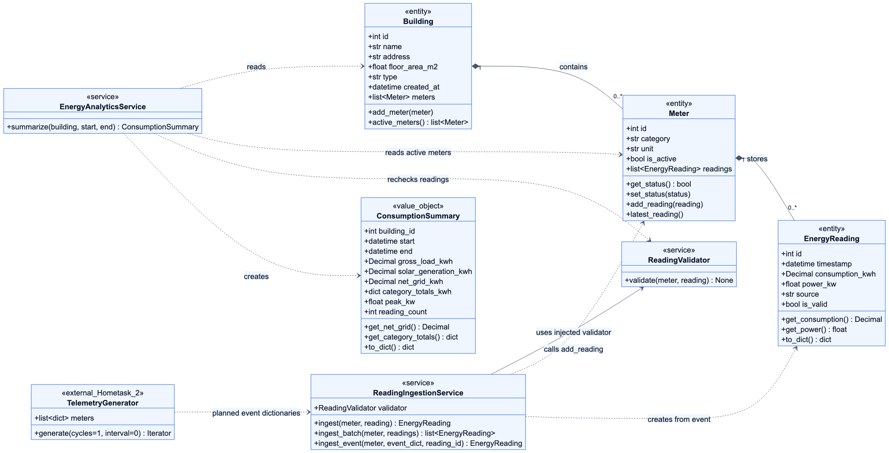
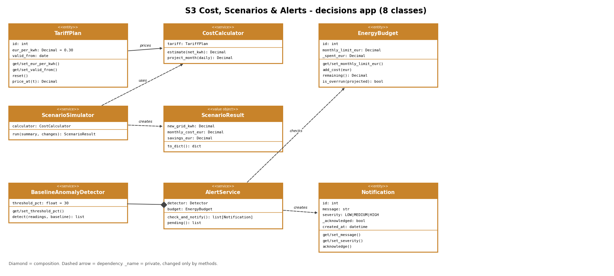

# AI-Powered Smart Energy Management System

**Group 25**

This is our Capstone project for the Compact Programming course at FH Dortmund. We are developing a system that monitors energy consumption in buildings, analyzes energy usage, and provides recommendations to help reduce energy waste.

For Home Assignment 1, we focused on the object-oriented programming part of the project. Each subsystem started with at least three Python classes using constructors, attributes, getters, setters, and basic methods. S1 now includes seven classes for monitoring, validation, ingestion, and analysis.

## Team Members

| Member | Student ID | Program | Subsystem | Python Classes |
|---|---|---|---|---|
| Rifat Ali Shaon | 7225871 | MDT | S1 — Energy Monitoring & Data Management | Building, Meter, EnergyReading, ReadingValidator, ReadingIngestionService, ConsumptionSummary, EnergyAnalyticsService |
| Syed Yasoob Raza | 7226703 | ESE | S2 — Sustainability & AI Coach | AIRecommendation, RecommendationFeedback, LLMRequestLog |
| Marwan Ahmed | 7226233 | MDT | S3 — Cost, Scenarios & Alerts | TariffPlan, CostCalculator, EnergyBudget, ScenarioSimulator, ScenarioResult, BaselineAnomalyDetector, AlertService, Notification |

## Our Implementation

We divided the project into three subsystems so that each member could work on their own part.

**S1 — Energy Monitoring & Data Management**

This part handles building information, energy meters, and energy readings. The `Building` class manages the meters in a building, while the `Meter` class stores readings and keeps track of whether a meter is active. The `EnergyReading` class represents an individual energy measurement.

The four additional classes build on these existing objects:

- `ReadingValidator` checks that the meter is active, the reading is marked valid, consumption is finite and nonnegative, power is finite, and the timestamp is timezone-aware UTC. Validation does not change either object. The original `EnergyReading` constructor still accepts naive timestamps for backward compatibility.
- `ReadingIngestionService` receives a validator and stores accepted readings through `Meter.add_reading()`. It can ingest one reading or a batch for one meter. It checks the whole batch before adding anything, so a failed validation leaves existing readings unchanged.
- `ConsumptionSummary` stores the building ID, time interval, load totals, solar generation, net grid energy, peak power, and reading count. Energy values use `Decimal` and become strings in `to_dict()` so serialization preserves their precision. Category totals contain only HVAC, LIGHTING, and PLUG loads.
- `EnergyAnalyticsService.summarize(building, start, end)` reads eligible readings without changing them. It includes `start` and excludes `end`. Inactive meters and invalid or non-UTC readings are excluded. The reading count includes accepted load and solar readings in the interval.

**Net Grid Energy = Gross Load Energy − Solar Generation**

Solar generation is kept separate from gross consumption. A negative net grid total represents export. The initial `peak_kw` is the maximum individual load-meter power reading, not the coincident peak for the whole building. An empty summary has zero energy, zero readings, and zero peak power.

Version 4 is our Capstone architecture reference. This Hometask 1 implementation keeps storage in memory and supports the existing HVAC, LIGHTING, PLUG, and SOLAR categories. Battery flows, Django/PostgreSQL persistence, authentication, duplicate detection, and a future-timestamp tolerance remain future Capstone work. Summaries recheck the readings currently stored on each meter; they do not maintain a separate ingestion history.

The planned Hometask 2 integration uses `ReadingIngestionService.ingest_event(meter, event_dict, reading_id)`. It checks that event meter IDs, categories, and activity match the destination meter, converts ISO timestamps ending in `Z` or `+00:00`, and stores the result as a simulated reading. Naive and non-UTC timestamps are rejected. `TelemetryGenerator` remains on `Homeworkassignment-02`; there is no duplicate implementation or cross-branch import here.

**S2 — Sustainability & AI Coach**

This part is responsible for energy-saving recommendations. It includes classes for storing recommendations, collecting user feedback, and keeping records of AI model requests.

**S3 — Cost, Scenarios & Alerts**

This part estimates energy costs and checks spending against monthly budgets. `TariffPlan` stores the electricity price, `EnergyBudget` tracks spending, and `CostCalculator` calculates energy costs and monthly projections. `ScenarioSimulator` estimates how energy-saving changes affect costs, and `ScenarioResult` stores the results.

`BaselineAnomalyDetector` compares energy readings with a baseline to find unusually high usage. `AlertService` checks budget overruns and anomalies, then creates `Notification` objects that users can acknowledge.

## UML Class Diagrams

We created UML class diagrams for each subsystem to show the class structure and relationships. The diagrams also include some classes that we plan to implement later in the Capstone project.

### S1 — Energy Monitoring & Data Management



[Editable Mermaid source](docs/uml/s1-hometask1.mmd) · [Full-size SVG](docs/uml/s1-hometask1.svg)

The diagram shows the seven implemented S1 classes, their attributes and main public methods. `TelemetryGenerator` is marked as an external Hometask 2 component with a planned connection. The shared validation functions are helpers, not additional classes.

### S2 — Sustainability & AI Coach


### S3 — Cost, Scenarios & Alerts



## Project Structure

Our Python classes are organized into separate folders for each subsystem.

```text
backend/
    monitoring/
        domain/
        services/
        tests/
    coach/
        domain/
        tests/
    decisions/
        domain/
        services/
        tests/

docs/
    uml/
```

The `domain` folders contain our Python classes, and the `tests` folders contain the test files.

For S1, `domain/consumption_summary.py` contains the summary object. The `services` folder contains `reading_validator.py`, `reading_ingestion_service.py`, and `energy_analytics_service.py`. The small `domain/validation.py` helper shares UTC checks and Decimal conversion between these classes.

## Running the Tests

We used Python's built-in `unittest` module to test our classes.

Run these commands from the main project folder:

**S1 — Energy Monitoring**

```bash
python3 -m unittest discover -s backend/monitoring/tests -v
```

**S2 — Sustainability & AI Coach**

```bash
python3 -m unittest discover -s backend/coach/tests -v
```

**S3 — Cost, Scenarios & Alerts**

```bash
python3 -m unittest discover -s backend/decisions/tests -v
```

## Video Presentation

Our Hometask 1 team presentation is available here:

**Video link:** [Watch the Hometask 1 presentation](https://drive.google.com/file/d/1CrDGMJruxwF7Y-yy8LFkol5h9B4SZE-J/view?usp=sharing)
