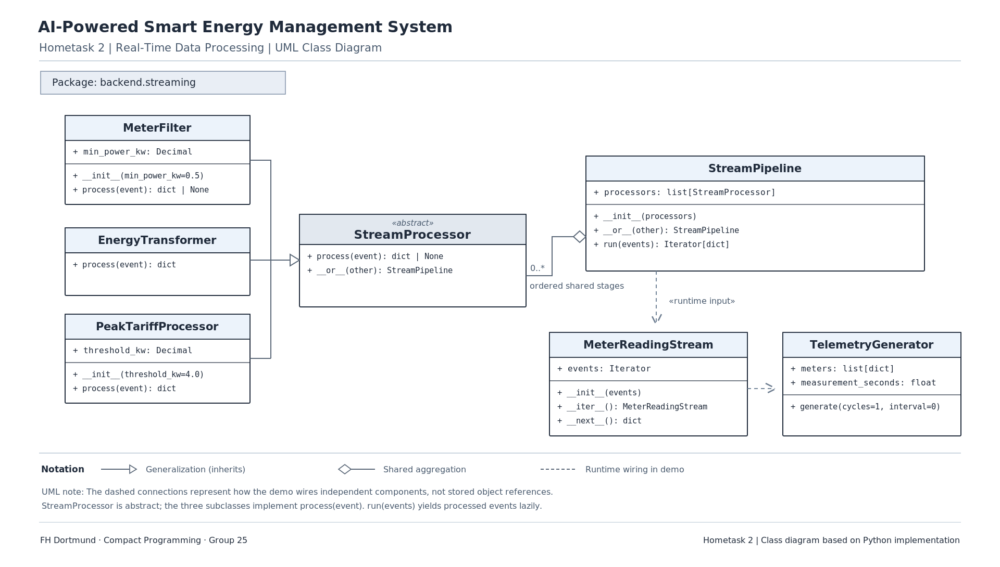

# AI-Powered Smart Energy Management System

**Group 25 | Compact Programming | FH Dortmund**

**Hometask 2: Real-Time Data Processing**

## 1. About the Project

Our Capstone project is an AI-Powered Smart Energy Management System. The goal is to monitor energy consumption in buildings, analyse energy usage, and support better energy management.

For Hometask 2, I focused on **real-time data processing using Python**.

I developed a small streaming framework that simulates incoming energy readings from HVAC systems, solar panels, and battery storage.

Instead of collecting all readings before processing them, the system processes each reading as it arrives. It filters unwanted readings, calculates energy contributions, and identifies high-power usage.

This assignment is implemented using Python without a database or web interface.

## 2. Team Members

| Name | Student ID | Programme |
|---|---|---|
| Rifat Ali Shaon | 7225871 | MDT |
| Syed Yasoob Raza | 7226703 | ESE |
| Marwan Ahmed | 7226233 | MDT |

**Hometask 2 was implemented individually by Rifat Ali Shaon**, as permitted by our professor.

## 3. Python Concepts Used

The main purpose of this assignment is to practise four important Object-Oriented Programming concepts.

| Concept | Implementation |
|---|---|
| Abstract Base Classes | `StreamProcessor` uses `ABC` and `@abstractmethod` to define a common processing interface. |
| Inheritance and Polymorphism | `MeterFilter`, `EnergyTransformer`, and `PeakTariffProcessor` inherit from `StreamProcessor` and implement their own `process()` methods. |
| Operator Overloading | The `__or__()` method allows processors to be connected using the `\|` operator. |
| Iterators and Generators | `MeterReadingStream` uses `__iter__()` and `__next__()`, while `TelemetryGenerator` and `StreamPipeline` use `yield`. |

These concepts allow the system to process events one at a time while keeping the code reusable and organised.

## 4. Main Classes

The streaming framework contains seven classes.

| Class | Description |
|---|---|
| `TelemetryGenerator` | Generates simulated energy readings from smart meters. |
| `MeterReadingStream` | Reads incoming events one by one using an iterator. |
| `StreamProcessor` | Abstract parent class that defines the common `process()` method. |
| `MeterFilter` | Filters inactive meters and readings below the minimum power threshold. |
| `EnergyTransformer` | Calculates how each reading contributes to grid energy. |
| `PeakTariffProcessor` | Identifies high-power consumption readings. |
| `StreamPipeline` | Connects the processors and executes them in order. |

Each class has a separate responsibility, which makes the program easier to understand and maintain.

## 5. How the Streaming Pipeline Works

The data follows this sequence:

```text
TelemetryGenerator
        |
        v
MeterReadingStream
        |
        v
MeterFilter
        |
        v
EnergyTransformer
        |
        v
PeakTariffProcessor
        |
        v
Processed Events
        |
        v
Terminal Output
```

First, `TelemetryGenerator` produces readings from simulated smart meters.

`MeterReadingStream` receives these readings one at a time.

`MeterFilter` checks whether the meter is active and whether its power is above the minimum threshold. Readings that do not meet these conditions are removed.

Next, `EnergyTransformer` calculates the energy contribution of each accepted reading.

Finally, `PeakTariffProcessor` checks whether the reading represents high-power consumption. The processed result is then printed in the terminal.

The pipeline uses `yield`, so it does not need to load the entire event stream into memory before processing.

### Connecting the processors

```python
pipeline = (
    MeterFilter(min_power_kw=0.5)
    | EnergyTransformer()
    | PeakTariffProcessor(threshold_kw=4.0)
)
```

The `|` operator makes the pipeline easy to build and read.

## 6. Energy Calculations

Each reading contains power in kilowatts (kW) and energy in kilowatt-hours (kWh).

Energy is calculated using:

```text
Energy (kWh) = Power (kW) × Measurement Duration (seconds) / 3600
```

For example, a 3 kW meter running for 60 seconds produces:

```text
3 × 60 / 3600 = 0.05 kWh
```

The transformer then calculates the contribution to grid energy.

| Energy source | Grid contribution |
|---|---|
| HVAC, lighting and plug loads | Positive (+) |
| Solar generation | Negative (-) |
| Battery charging | Positive (+) |
| Battery discharging | Negative (-) |

A positive value increases grid demand, while a negative value reduces it.

These are individual energy contributions, not a complete building energy balance.

The system also marks readings as `PEAK` when consumption power is strictly above the configured threshold. This is only a high-power flag, not an electricity billing calculation.

## 7. UML Class Diagram

The UML diagram shows the seven classes, their important attributes and methods, and the relationships between them.

It also shows inheritance from `StreamProcessor`, shared processors in `StreamPipeline`, and how the streaming components are connected during execution.



## 8. Project Structure

```text
AI-Powered-Smart-Energy-Management-System/
|
|-- backend/
|   |-- streaming/
|       |-- __init__.py
|       |-- source.py
|       |-- processors.py
|       |-- demo.py
|       |-- tests/
|           |-- test_source.py
|           |-- test_processors.py
|
|-- docs/
|   |-- uml/
|       |-- Streaming-UML_HT2.png
|
|-- .gitignore
|-- README.md
```

The `source.py` file contains the generator and iterator classes.

The `processors.py` file contains the abstract processor, filtering, transformation, peak detection, and pipeline implementation.

The `demo.py` file runs the simulation, while the `tests` folder contains the unit tests.

## 9. Running the Application

The project uses Python 3.9 or later and does not require additional external libraries.

Open a terminal in the project root directory.

To run the simulation:

```bash
python3 -m backend.streaming.demo --cycles 5 --interval 2 --seed 25
```

The options mean:

- `--cycles 5`: Generate readings for five cycles.
- `--interval 2`: Wait two seconds between cycles.
- `--seed 25`: Use repeatable simulated power values.

Each reading represents 60 seconds of energy measurement by default. The two-second interval is only the waiting time used to demonstrate streaming.

### Example Results

During one demonstration, the program produced:

```text
Generated 25; accepted 19; filtered 6.
```

This means:

- 25 events were generated by the smart meters.
- 19 events passed through the processing pipeline.
- 6 events were removed by the filter.

The terminal also displays accepted readings, including their meter category, power, energy contribution, and whether they were marked as `PEAK`.

The output appears gradually as the simulation runs, demonstrating incremental processing.

## 10. Unit Testing

I used Python's built-in `unittest` framework to test the implementation.

To run the tests:

```bash
python3 -m unittest discover -s backend/streaming/tests -v
```

**Test results:**

| Result | Count |
|---|---|
| Tests passed | 43 |
| Tests failed | 0 |

The tests cover the generator and iterator, abstract classes, inheritance, operator overloading, filtering, energy calculations, battery charging and discharging, peak detection, and complete pipeline processing.

## 11. Video Presentation

A five-minute solo presentation demonstrates the streaming framework, explains the main Python concepts, and shows the program running in the terminal.

**Video link:** To be added before submission.

## 12. Conclusion

This is a simplified simulation. It does not connect to physical smart meters, store data in a database, or calculate electricity bills. The streaming logic can later be integrated into the Energy Monitoring subsystem of our main Capstone project.