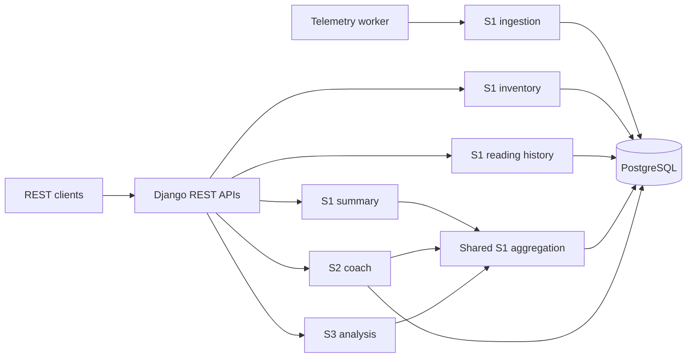

# AI-Powered Smart Energy Management System

Capstone project · Compact Programming Course (CPC) · FH Dortmund · Group 25

The system stores simulated building-energy readings and exposes Django REST APIs
for monitoring, energy recommendations and tariff-based cost scenarios. The
simulator is the intended data source; physical IoT integration is not planned.
The current application targets local development and university demonstrations.

## Team

| Member | Student ID | Program | Responsibility |
| --- | --- | --- | --- |
| Rifat Ali Shaon | 7225871 | MDT | S1 — Energy Monitoring & Data Management |
| Syed Yasoob Raza | 7226703 | ESE | S2 — Sustainability & AI Coach |
| Marwan Ahmed | 7226233 | MDT | S3 — Cost, Scenarios & Alerts |

## Implementation status

| Area | Implemented | Incomplete or limited |
| --- | --- | --- |
| S1 monitoring | Building/meter management, PostgreSQL validation and constraints, interval ingestion, simulated telemetry, history and summaries | Activation history and reviewed legacy-data repair workflows |
| S2 coach | Daily heuristic forecasts, illustrative assessment, rule-based recommendations, optional OpenAI integration, request logs and stored feedback | Calibrated prediction uncertainty, measured savings and authenticated feedback ownership |
| S3 analysis | Validated global tariff (one active), interval import/export cost estimates, what-if scenarios, stored cost reports, rule-based alert detection with resolve/filter | Scheduled alert detection, historical/per-building tariffs, invoices and statistical anomaly detection |
| Runtime | Docker Compose database, migration job, Gunicorn API server and separate telemetry worker | Public deployment hardening and operational backup/restore tooling |
| Accounts | Installed Django app scaffold; Django's built-in auth/admin components remain available | Custom account/authentication APIs and per-user building permissions |
| Frontend | Streamlit dashboard (`frontend/app.py`): overview, costs, scenarios, alerts, reports, forecast, recommendations and feedback | Runs on the host, not in Docker Compose; no login |

## Architecture and data flow

The backend uses Django 5.2, Django REST Framework and PostgreSQL exclusively.
The telemetry command discovers current inventory each cycle and saves readings
through the S1 ingestion service. Management APIs use the inventory service;
reading history uses the ORM. S1 summaries, S2 and S3 call the **same S1 Python
aggregation functions inside Django**. S2/S3 do not call the S1 summary HTTP route.
Forecasts, recommendations and request logs are stored in PostgreSQL.



Arrows show service calls and database access. The Streamlit dashboard in `frontend/`
calls the HTTP APIs from the host.

## Repository structure

```text
.
├── Dockerfile, compose.yaml, .dockerignore
├── .env.docker.example           # Docker configuration template
├── .env.example                  # Optional host configuration template
├── requirements.txt
├── backend/
│   ├── config/                   # Settings, routes and WSGI/ASGI entry points
│   ├── monitoring/
│   │   ├── models.py, serializers.py, views.py, urls.py
│   │   ├── services/             # Inventory, ingestion, generator, aggregation
│   │   └── management/commands/  # run_telemetry, setup_demo_inventory, seed_demo_data
│   ├── coach/                    # Forecasting, recommendations, assessment
│   ├── analysis/                 # Tariffs, costs, scenarios, reports, alert detection
│   └── accounts/                 # Scaffold
├── frontend/                     # Streamlit dashboard (see frontend/README.md)
└── docs/                         # Setup, API and measurement documentation
    ├── uml/                      # Placeholder
    └── presentations/            # Placeholder
```

## Docker quickstart

Examples use **Bash or zsh on macOS/Linux**, from the repository root. Docker
Desktop with Compose is required; the setup supports native Apple Silicon builds.
Bash functions and heredocs are not PowerShell syntax.

1. Create private `.env.docker` from the tracked example using the
   [configuration instructions](docs/docker-development.md#first-setup). Existing
   private files must be retained; secrets are not committed.
2. Define the helper and start the services:

   ```sh
   dc() { docker compose --env-file .env.docker -p smart-energy "$@"; }
   dc config --quiet
   dc build backend
   dc up -d
   dc ps -a
   ```

   Database and backend should be healthy, telemetry running, and `migrate`
   **Exited (0)**. Startup applies migrations to Docker's database only; it does
   not create inventory or copy host data.
3. Explicitly initialize the demo:

   ```sh
   dc exec backend python backend/manage.py setup_demo_inventory
   dc logs --tail 10 telemetry
   ```

   The command creates one building and four active meters, or verifies an
   already-compatible set without overwriting it. Incompatible inventory is
   rejected. Wait two UTC minute boundaries after meter creation for the first
   eligible completed interval. A meter created at 12:00:30 can first receive the
   12:01–12:02 reading, processed at 12:02.
4. Inspect the APIs, substituting the printed building ID:

   ```sh
   curl -fsS http://127.0.0.1:8000/api/buildings/
   curl -fsS 'http://127.0.0.1:8000/api/buildings/1/readings/?page_size=8'
   curl -fsS http://127.0.0.1:8000/api/buildings/1/summary/
   ```

The backend is published at `127.0.0.1:8000`; PostgreSQL has no published host
port. Docker has its own persistent database, separate from Postgres.app or other
host PostgreSQL installations. Ordinary `dc down` retains that volume; do not add
`-v` for routine shutdown. See [Docker operations](docs/docker-development.md)
for configuration, logs and restart details, or [host development](docs/host-development.md)
for an optional non-Docker setup. A separate simulation database is not required.

## API overview

The `/api/monitoring/`, `/api/coach/` and `/api/analysis/` prefixes also expose their
subsystems' routes. The table uses the shared `/api/` convenience prefix.

| Subsystem | Route | Methods | Purpose |
| --- | --- | --- | --- |
| S1 | `/api/buildings/` | GET, POST | List/create buildings |
| S1 | `/api/buildings/{id}/` | GET, PUT, PATCH | Retrieve/update building details |
| S1 | `/api/buildings/{id}/meters/` | GET, POST | List/create assigned meters |
| S1 | `/api/meters/{id}/` | GET, PATCH | Retrieve meter or change active status |
| S1 | `/api/buildings/{id}/readings/` | GET | Paginated, filtered history |
| S1 | `/api/buildings/{id}/summary/` | GET | All-history energy summary |
| S2 | `/api/buildings/{id}/forecast/` | GET, POST | Calculate and store a seven-day daily heuristic forecast |
| S2 | `/api/recommendations/generate/` | POST | Generate/store recommendations when observations suffice |
| S2 | `/api/recommendations/` | GET | List stored recommendations |
| S2 | `/api/recommendations/{id}/feedback/` | POST | Store validated feedback (`1–5` rating) for `{id}` |
| S3 | `/api/tariffs/`, `/api/tariffs/{id}/` | GET, POST; GET, PUT, PATCH | List/create/update validated tariff plans (one active) |
| S3 | `/api/buildings/{id}/cost/` | GET | Interval-based tariff scenario |
| S3 | `/api/buildings/{id}/scenarios/` | POST | What-if re-pricing (tariff, consumption, solar) |
| S3 | `/api/buildings/{id}/reports/`, `/api/reports/` | GET, POST; GET | Generate and list stored cost reports |
| S3 | `/api/alerts/`, `/api/alerts/detect/`, `/api/alerts/{id}/` | GET; POST; GET, PUT, PATCH | List, detect and resolve alerts (only `is_resolved` is writable) |

Forecasting requires at least two complete UTC days in the preceding 14 completed
calendar days. A fresh demo may therefore return unavailable results. Cost
estimates require matched intervals and exactly one applicable active global
tariff. Docker leaves external AI calls disabled. See the
[S1 API contract](docs/s1-management-api.md) and
[S2/S3 API guide](docs/coach-analysis-api.md) for request examples and prerequisites.

## Testing

Use a **separate disposable PostgreSQL test database**, never an application
or demonstration database. The [testing guide](docs/testing.md) provides Docker,
working-tree and host commands with external AI calls disabled.

Tests cover validation, database constraints, interval calculations, management
and history APIs, selected PostgreSQL concurrency cases, generator scheduling,
legacy migration behavior, demo setup and graceful shutdown. They do not establish
forecast accuracy, real-world energy savings, load capacity or public-deployment
security. The OpenAI integration is mocked during tests. Test count alone is not
an assessment of capstone completeness.

## Measurement assumptions and limitations

- `energy_kwh` is energy for an explicitly defined interval. Telemetry uses
  60-second UTC intervals; hourly demo data remains hourly and legacy unknown
  durations remain unknown.
- Main `ELECTRICITY` is gross building load. HVAC and lighting are included
  submeters; solar is separate generation. Deactivation preserves readings.
- Zero is an observation, not missing data. Missing/ambiguous coverage can return
  `null`; baseline values are references, not replacements for observations.
- The no-battery model estimates import/export separately per matching interval.
  `net_grid_consumption_kwh` is a signed recorded balance, not measured grid flow.
- Forecast bands and recommendation scores are illustrative. Cost estimates are
  scenarios, not complete utility bills; fixed fees, taxes and contract history
  are not modeled.
- Permissions are `AllowAny`, CORS is permissive, and custom authentication and
  per-user access control are incomplete. Localhost binding is not sufficient
  for public internet deployment.
- The dashboard has no authentication, and current UML diagrams are not tracked.
  Submission requirements must be assessed against the university rubric.

## Documentation

| Guide | Scope |
| --- | --- |
| [Docker development](docs/docker-development.md) | Private configuration, services, demo setup, logs and persistence |
| [Host development](docs/host-development.md) | Optional virtual environment and host PostgreSQL setup |
| [Testing](docs/testing.md) | Isolated databases, commands and coverage limits |
| [S1 management APIs](docs/s1-management-api.md) | Dashboard-facing routes, validation and history filters |
| [S2/S3 APIs](docs/coach-analysis-api.md) | Forecast/recommendation behavior and tariff prerequisites |
| [Energy calculations](docs/energy-calculations.md) | Shared measurement policy, unavailable values and cost semantics |
| [Reading ingestion](docs/reading-ingestion.md) | Single-reading validation, retries and transactions |
| [Simulated telemetry](docs/simulated-telemetry.md) | Inventory rules, synthetic profile and scheduling |

## Historical coursework resource

[Assignment 3 API demonstration video](https://drive.google.com/file/d/1buvqB7mQ5Sy1reJsuSwuxF97OFEm9avi/view?usp=sharing)
is retained as a historical resource, not a verified current capstone demo.
[Project repository](https://github.com/Techrifat97/AI-Powered-Smart-Energy-Management-System).
