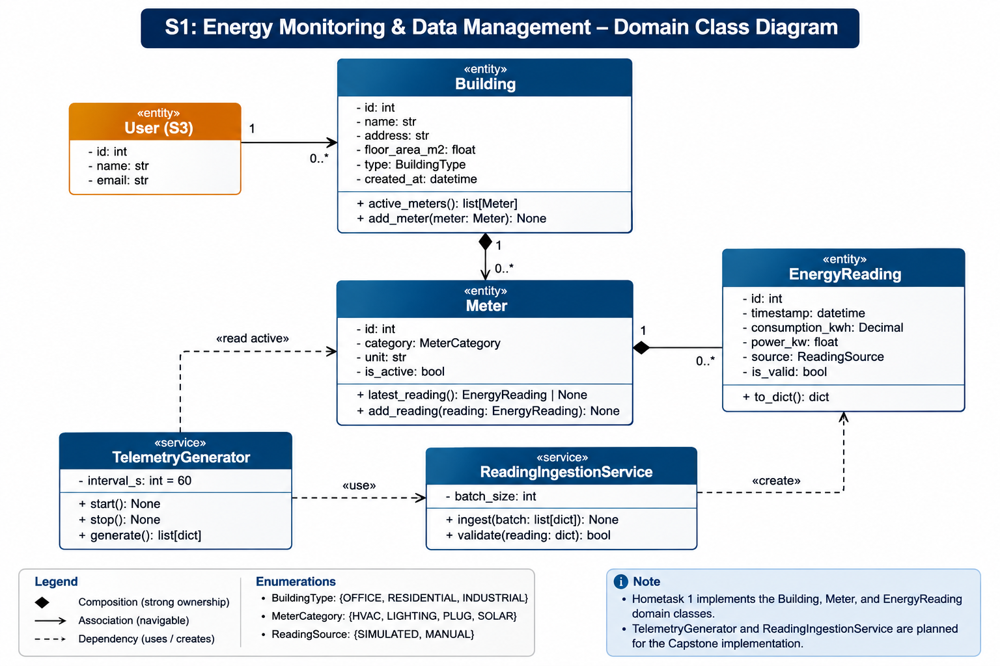
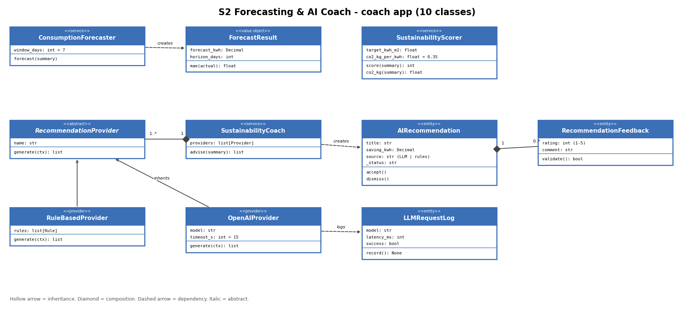
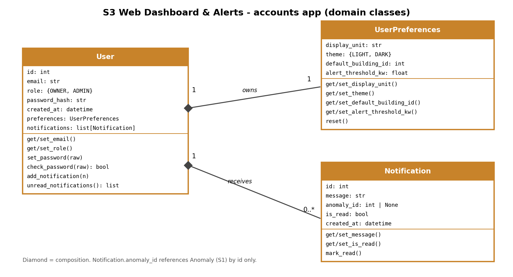

# AI-Powered Smart Energy Management System

This is our Capstone project for the Compact Programming course at FH Dortmund. We are developing a system that monitors energy consumption in buildings, analyzes energy usage, and provides recommendations to help reduce energy waste.

For Home Assignment 1, we focused on the object-oriented programming part of the project. Each team member implemented three Python classes from their subsystem using constructors, attributes, getters, setters, and basic methods.

## Team Members

| Member | Subsystem | Python Classes |
| ------- | --------------------------------- | ------------------------------------------------------- |
| Shaon | S1 — Energy Monitoring & Analysis | Building, Meter, EnergyReading |
| Yassoub | S2 — Sustainability & AI Coach | AIRecommendation, RecommendationFeedback, LLMRequestLog |
| Marwan | S3 — Web Dashboard & Alerts | User, UserPreferences, Notification |

## Our Implementation

We divided the project into three subsystems so that each member could work on their own part.

**S1 — Energy Monitoring & Analysis**

This part handles building information, energy meters, and energy readings. The `Building` class manages the meters in a building, while the `Meter` class stores readings and keeps track of whether a meter is active. The `EnergyReading` class represents an individual energy measurement.

**S2 — Sustainability & AI Coach**

This part is responsible for energy-saving recommendations. It includes classes for storing recommendations, collecting user feedback, and keeping records of AI model requests.

**S3 — Web Dashboard & Alerts**

This part manages users, their dashboard preferences, and notifications. Users can update their preferences and receive notifications related to the system.

## UML Class Diagrams

We created UML class diagrams for each subsystem to show the class structure and relationships. The diagrams also include some classes that we plan to implement later in the Capstone project.

### S1 — Energy Monitoring



### S2 — Sustainability & AI Coach



### S3 — Web Dashboard & Alerts



## Project Structure

Our Python classes are organized into separate folders for each subsystem.

```text
backend/
    monitoring/
        domain/
        tests/
    coach/
        domain/
        tests/
    accounts/
        domain/
        tests/

docs/
    uml/
```

The `domain` folders contain our Python classes, and the `tests` folders contain the test files.

## Running the Tests

We used Python's built-in `unittest` module to test our classes.

Run these commands from the main project folder:

**S1 — Energy Monitoring**

```bash
python3 -m unittest discover -s backend/monitoring/tests -v
```

**S2 — Sustainability & AI Coach**

```bash
python3 -m unittest discover -s backend/coach/tests -v
```

**S3 — Web Dashboard & Alerts**

```bash
python3 -m unittest discover -s backend/accounts/tests -v
```

## Video Presentation

Our Hometask 1 team presentation is available here:

**Video link:** [Watch the Hometask 1 presentation](https://drive.google.com/file/d/1CrDGMJruxwF7Y-yy8LFkol5h9B4SZE-J/view?usp=sharing)

## Next Steps

Home Assignment 1 covers the basic OOP implementation. We will continue developing the project by adding data streaming, database integration, APIs, AI recommendations, and a React dashboard in the next stages.
