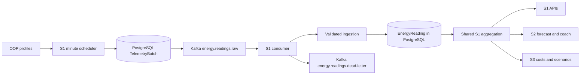

# S1 Kafka delivery and recovery

Kafka transports synthetic telemetry only. PostgreSQL remains the data source for
REST APIs and the shared S1 aggregation used directly by S2 and S3. They do not
consume Kafka or depend on broker availability to read stored observations.



Kafka separates calculation/publication from ingestion and demonstrates replayable
stream processing. Its cost here is extra services, transport delay and operational
state. This single-node KRaft deployment is deliberately a local university MVP.

## Event contract

Raw topic: `energy.readings.raw`, three partitions, replication factor one.
The key is the building ID: all of its meters share ordering in one partition.
A message contains a **whole building-minute**, instead of separate independently
committable meter messages. This preserves the previous generator's atomic guarantee.

```json
{
  "schema_version": 1,
  "batch_id": "<deterministic UUID from building and minute>",
  "building_id": 1,
  "timestamp": "2026-11-12T12:00:00+00:00",
  "interval_seconds": 60,
  "has_solar_installation": false,
  "readings": [{"meter_id": 1, "device_id": "MAIN", "meter_type": "ELECTRICITY",
                "energy_kwh": 0.2, "power_kw": 12.0, "voltage": 230.0}]
}
```

The sample UUID placeholder must be replaced by `batch_id()`; it is not a valid event.
Schema validation rejects unknown versions/fields, repeated JSON fields, duplicate
or unordered meter IDs, noncanonical/non-UTC/minute timestamps, invalid durations,
nonfinite/negative/non-numeric values and raw payloads over 900000 bytes. Power is
still an instantaneous sample: ingestion does not impose kWh=kW/60 on incoming data.
The consumer requires the exact matching durable outbox payload, so this is an
internal simulator protocol, not a general third-party sensor ingestion endpoint.

## Producer

`run_telemetry --mode kafka` re-queries current inventory every UTC minute. It locks
the building then all meters in PK order, validates inventory and freezes the batch
in `TelemetryBatch`. It never inserts live EnergyReading rows itself. The UUID and
unique building/timestamp constraint prevent changing an already staged minute.

`publish_pending()` sends pending rows in timestamp/building order. Producer idempotence
and `acks=all` are enabled. A callback and flush must confirm broker acknowledgment;
only then is `published_at` updated. Failure leaves the outbox available for retry,
logs a failure and stops the worker; Compose restarts it. All unprocessed, nonrejected
batches are republished, including previously acknowledged ones. This recovers from
a crash between broker acknowledgment and the database status update. It may deliver
duplicates. Unconsumed durable outbox payloads also survive broker data loss, but this
is not a replicated broker or a backup strategy.

A cycle stages the latest completed minute only. Retrying old **staged** events is
recovery; inventing readings for minutes missed during downtime is not performed.

## Consumer and database transaction

`consume_telemetry` uses group `s1-ingestion-v1`, `auto.offset.reset=earliest` and
manual synchronous commits. `process_event()`:

1. Validates JSON/version, identifiers, time and measurements.
2. Locks the building, all current meters in PK order, then the outbox row.
3. Verifies the exact outbox and building/meter identities.
4. If its committed receipt exists, returns `already_processed` with no reading writes.
5. Otherwise rechecks current active eligible inventory and solar metadata. Any
   changed member/status/type or incompatible existing partial minute rejects the batch.
6. Calls existing `ingest_reading()` for every member. Existing numeric/full_clean,
   unique key, conflicting-retry and overlap rules remain active.
7. Marks `processed_at` in the **same PostgreSQL transaction** as all readings.
8. Commits the Kafka offset only after that transaction returns successfully.

A crash before database commit rolls back the whole building-minute. A crash after
commit but before offset commit replays its receipt without duplicate rows. This
also permits an already committed replay after later meter deactivation: it writes
nothing. A pending event for a now-deactivated meter is rejected rather than creating
new readings. Activations at cycle time and `created_at <= interval_start` determine
eligibility; historical activation timestamps are still not modeled.

All cooperating services use building → meters → batch lock order. Raw ORM/SQL
writers bypass inventory and overlap checks; uniqueness still applies. PostgreSQL
READ COMMITTED is assumed. There is no distributed exactly-once guarantee.

## Invalid events and failures

A permanent Django ValidationError sends an envelope to `energy.readings.dead-letter`
with source topic/partition/offset, reason and bounded base64 payload. The consumer
waits for DLQ acknowledgment, marks a matching legitimate outbox rejected, then
commits the source offset. Invalid/conflicting forged messages cannot mark a different
valid outbox rejected. DLQ publication failure stops progress without committing.
Transient database errors and unexpected exceptions also leave the source offset
uncommitted. DLQ or receipt duplicates remain possible around crashes and are safe.

Inspect `dc logs --tail 50 telemetry consumer`, outbox `last_error` and the DLQ. Do
not automatically clear rejected receipts or edit their frozen payloads: review the
inventory/legacy overlap first. No automated repair/replay UI is included. Outbox rows
and DLQ data are retained; a reviewed retention/archive policy is future work. Kafka's
normal topic retention still applies; pending DB batches can be republished.

Single-node `acks=all` means one broker acknowledgment, not replicated fault tolerance.
Losing both database/outbox and broker storage loses data. Authentication, TLS,
backups, metrics and multiple-node availability are outside this demonstration.

## Implementation references

- [Kafka service functions](../backend/monitoring/services/kafka_pipeline.py)
- [Producer scheduler](../backend/monitoring/management/commands/run_telemetry.py)
- [Consumer command](../backend/monitoring/management/commands/consume_telemetry.py)
- [PostgreSQL Kafka tests](../backend/monitoring/test_kafka_pipeline.py)
- [Apache's KRaft Docker example](https://github.com/apache/kafka/blob/trunk/docker/examples/docker-compose-files/single-node/plaintext/docker-compose.yml)
- [Confluent Python delivery/commit API](https://docs.confluent.io/platform/current/clients/confluent-kafka-python/html/index.html)
