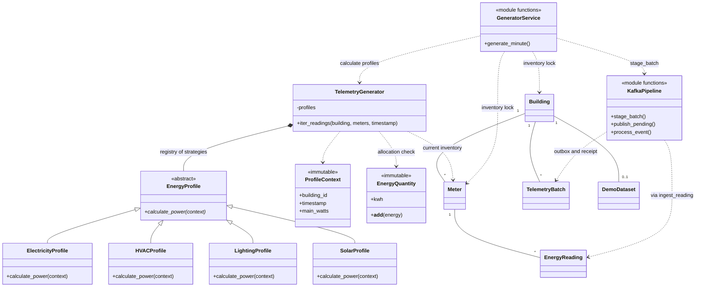

# S1 OOP architecture

Django models remain persistence objects. Profile classes calculate synthetic power;
plain service functions handle inventory, ingestion, transactions and Kafka.
No homework-only model hierarchy or enterprise framework is introduced.

| Concept | Actual implementation |
| --- | --- |
| Abstraction / ABC | `EnergyProfile.calculate_power(context)` defines the integer-watt interface; the ABC cannot be instantiated. |
| Inheritance / overriding | `ElectricityProfile`, `HVACProfile`, `LightingProfile`, `SolarProfile` inherit and implement that method. |
| Polymorphism | `TelemetryGenerator.iter_readings()` dispatches through the meter-type strategy registry. |
| Encapsulation | The generator copies its registry into a read-only mapping; `ProfileContext` and `EnergyQuantity` are frozen dataclasses. ORM inventory is reloaded each cycle. |
| Composition | A `TelemetryGenerator` owns collaborating profile instances; it does not inherit from a meter or a Django model. |
| Generator / iterator | `iter_readings()` uses `yield`; direct ingestion, outbox construction and hourly bootstrap consume it. A durable JSON batch necessarily materializes that one building-minute. |
| Operator overloading | `EnergyQuantity.__add__` adds kWh to kWh. The real generator checks combined included-submeter energy against gross energy. Adding raw power/numbers raises TypeError. |

Code: [profiles.py](../backend/monitoring/services/profiles.py),
[orchestration](../backend/monitoring/services/generator.py),
[ingestion](../backend/monitoring/services/ingestion.py),
[Kafka services](../backend/monitoring/services/kafka_pipeline.py).

The v1 SHA-256 seed, integer-watt budgets and 60-second float calculation are
preserved. Main electricity is gross load; HVAC (30%) and lighting (15%) share
category budgets, not additional consumption. Solar is separate. Hourly demo
energy uses its explicit 3600-second duration. These synthetic profiles assume
constant interval power, whereas ingestion permits an independent instantaneous
power sample. Main/solar interval alignment remains aggregation's responsibility.

## Implemented UML

The source is [s1-telemetry.mmd](uml/s1-telemetry.mmd). `KafkaPipeline` and `GeneratorService` below denote
module functions rather than extra Python classes.

`DemoDataset` adds stable bootstrap identity. `TelemetryBatch` is both a durable
producer outbox and an atomic consumer receipt; existing public model fields and
relationships are unchanged. Migration 0004 only creates these two tables.
The existing initial and measurement migrations are retained.
