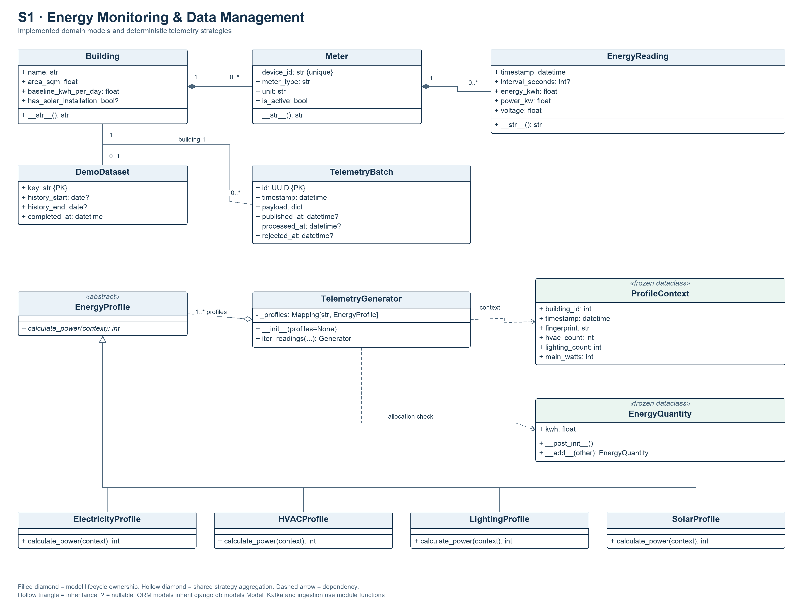

# S1 — Energy Monitoring & Data Management

## 1. Subsystem Overview

S1, owned by Rifat Ali Shaon, manages buildings and meters, simulates interval
measurements, transports telemetry through Kafka, validates and stores readings,
and provides shared energy calculations. Django 5.2, Django REST Framework,
PostgreSQL, the Confluent Kafka client and Python profile strategies implement
this workflow. The Streamlit dashboard uses S1 HTTP APIs. S2 and S3 call the shared
aggregation functions inside Django and read PostgreSQL.

The simulator is the current measurement source. Its profiles represent synthetic
building loads. Baselines provide comparison values. Building ownership and
historical installation changes have no dedicated data model.

## 2. Functional Requirements

| ID | Functional Requirement | Implementation | Verification |
|---|---|---|---|
| S1-FR-01 | The system shall create and update building metadata with explicit solar-installation status on creation. | `BuildingSerializer`, `save_building()` | `ManagementAPITests.test_building_creation_requires_explicit_solar_status_and_creates_no_meters`, `test_descriptive_update_and_existing_read_response_fields` |
| S1-FR-02 | The system shall assign uniquely identified meters to buildings and change active status subject to inventory rules. | `MeterSerializer`, `save_meter()` | `ManagementAPITests`, `InventoryConcurrencyAPITests` |
| S1-FR-03 | The simulator shall rediscover eligible meters each cycle and generate deterministic measurements for completed 60-second UTC intervals. | `generate_minute()`, `TelemetryGenerator.iter_readings()` | `GeneratorTests.test_inventory_is_requeried_for_activation_and_deactivation`, `test_retry_is_deterministic_and_preserves_every_stored_value` |
| S1-FR-04 | Ingestion shall validate one active meter's reading and reject invalid measurements, conflicting retries and overlapping or unresolved coverage. | `ingest_reading()` | `IngestionTests`, `PostgreSQLIngestionConcurrencyTests` |
| S1-FR-05 | The producer shall persist a building-minute outbox before publication and require Kafka acknowledgment. | `TelemetryBatch`, `stage_batch()`, `publish_pending()` | `KafkaPipelineTests.test_publish_ack_and_replay_unprocessed`, `test_publish_failure_leaves_durable_batch` |
| S1-FR-06 | The consumer shall persist all batch members and their receipt atomically and recognize committed replays. | `process_event()`, `handle_message()` | `KafkaPipelineTests.test_stage_only_then_atomic_persistence_and_retry`, `ConcurrentBatchTests` |
| S1-FR-07 | The consumer shall deliver permanently invalid messages to the dead-letter topic before committing their source offsets. | `dead_letter()`, `handle_message()` | `KafkaPipelineTests.test_offset_commit_after_success_and_acknowledged_deadletter` |
| S1-FR-08 | Demo initialization shall create 14 complete previous UTC days for empty dedicated inventory and preserve populated datasets on repeated execution. | `bootstrap_demo()`, `DemoDataset` | `BootstrapTests.test_full_history_and_restart_rename`, `test_existing_history_adopted_without_repair` |
| S1-FR-09 | The history API shall return paginated readings scoped by building, optional meter and aware interval-start bounds, including inactive-meter history. | `BuildingReadingHistoryView`, `ReadingHistoryQuerySerializer` | `ReadingHistoryAPITests` |
| S1-FR-10 | Shared summaries shall distinguish measured zero, missing data and ambiguous coverage while separating gross consumption from solar generation. | `building_energy_report()`, `summarize_building()` | `BuildingAggregationTests`, `EnergyIntegrationTests` |

## 3. Non-Functional Requirements

| ID | Non-Functional Requirement | Implementation / Evidence |
|---|---|---|
| S1-NFR-01 | Numeric accuracy shall require finite positive floor area and finite nonnegative baseline, energy, power and voltage. | Model validators and PostgreSQL check constraints, exercised by `MonitoringModelTests`. |
| S1-NFR-02 | Database consistency shall permit at most one reading per meter and timestamp. | `s1_reading_meter_timestamp_unique`, including bulk-write and concurrent-race tests. |
| S1-NFR-03 | Failed batch processing shall leave no newly inserted partial building-minute. | Outer transaction in `process_event()`, overlap rollback tests. |
| S1-NFR-04 | Delivery recovery shall retain pending outbox rows after publication failure and reuse a committed receipt after replay. | Acknowledged producer, durable outbox and receipt tests. The transport uses at-least-once delivery. |
| S1-NFR-05 | Domain APIs shall authenticate users before serving or changing S1 data. | Explicit `IsAuthenticated` permissions. The public health route uses `AllowAny`. |
| S1-NFR-06 | History responses shall default to 100 rows and cap requested page size at 500. | `ReadingHistoryPagination`, `test_page_size_is_bounded`. A three-query fixture checks joined reading retrieval. |
| S1-NFR-07 | Profile extension shall use the common `calculate_power()` interface and an injectable registry. | ABC, four overrides, read-only mapping and injected-strategy test. |
| S1-NFR-08 | Runtime portability shall use PostgreSQL with the supplied Python 3.13 Docker image and KRaft broker. | `Dockerfile`, `compose.yaml`. |
| S1-NFR-09 | Automated verification shall isolate PostgreSQL test data and support controlled clocks and mocked broker I/O. | Settings guard `DB_TEST_NAME`, scheduler tests and Kafka mocks. |
| S1-NFR-10 | Timestamp consistency shall require aware UTC minute starts and explicit 60-second durations for new telemetry. | `validate_interval_timestamp()`, strict ingestion guards and timestamp/duration tests in `IngestionTests`. |

## 4. UML Class Diagram



Model associations show foreign keys and supported multiplicities. The profile
registry is shown as shared aggregation because callers may supply profile
instances. The default generator constructs the four strategies internally.
Standalone ingestion, Kafka and aggregation functions appear in the workflow text.

## 5. Important Classes and Responsibilities

| Class | Responsibility | Important Methods |
|---|---|---|
| `Building` | Name, location, floor area, baseline and nullable solar status. | `__str__()` |
| `Meter` | Building assignment, unique device ID, type, unit and active state. | `__str__()` |
| `EnergyReading` | Interval timestamp, nullable duration, kWh, sampled kW and voltage. | Inherited `full_clean()`, `save()`, `__str__()` |
| `TelemetryBatch` | UUID-keyed outbox payload and publication, processing and rejection state. | Inherited ORM methods |
| `DemoDataset` | Stable demo identity and original seeded date bounds. | Inherited ORM methods |
| `EnergyProfile` | Abstract integer-watt calculation interface. | `calculate_power()` |
| `ElectricityProfile`, `HVACProfile`, `LightingProfile`, `SolarProfile` | Deterministic main load, shared submeter budgets and solar curve. | Four overrides of `calculate_power()` |
| `TelemetryGenerator` | Compose profile objects and yield measurements. | `__init__()`, `iter_readings()` |
| `ProfileContext` | Frozen simulation inputs, including inventory fingerprint and main watts. | Dataclass constructor |
| `EnergyQuantity` | Frozen nonnegative kWh quantity and compatible energy addition. | `__post_init__()`, `__add__()` |

Inheritance and abstraction occur in the profile hierarchy. Registry dispatch
provides polymorphism. A copied read-only mapping and frozen dataclasses provide
encapsulation. `yield` creates a Python generator consumed by real telemetry and
historical initialization. `EnergyQuantity.__add__()` checks combined included
submeter energy against gross energy. Addition accepts another energy quantity.

## 6. Internal Architecture and Data Flow

### Inventory and measurement rules

Inventory services lock the building, then meters in primary-key order. Creation
and activation allow at most one active main and one active solar meter. Telemetry
requires exactly one active main, explicit solar metadata, and one active solar
meter when solar is installed. A confirmed no-solar building cannot have configured
solar meters. A meter qualifies when `created_at <= interval_start`. Activation is
observed at cycle time. Deactivation preserves historical readings.

A new building starts with metadata. Meter creation is separate. Solar meaning can
change only before any building reading exists. Meter identity is immutable through
the management API. Device IDs are globally unique.

`energy_kwh` records energy during `[timestamp, timestamp + interval_seconds)`.
Live intervals have duration 60 seconds. Historical demo intervals have duration
3600 seconds. Unknown legacy duration stays null. `power_kw` is an independent
instantaneous sample. Ingestion accepts explicit Python numeric inputs and an aware,
zero-offset UTC minute timestamp. Adjacent intervals are allowed. A known overlap
or an unknown-duration reading starting before the new interval's end blocks a new
same-meter interval. Exact valid retries return `(existing_reading, False)`.
Different values raise Django `ValidationError`. New readings return `(reading, True)`.

### Synthetic generation and Kafka

Weekday daytime main load is 12 kW plus deterministic variation below 1 kW.
Weekend daytime uses 8 kW and other hours use 4 kW. HVAC shares at most 30% of main
load and lighting shares at most 15%, divided among eligible category meters.
Solar follows a triangular UTC daytime curve with a 10 kW noon peak and recorded
night zeros. Voltage is 230 V. SHA-256 incorporates profile version, building ID,
minute and ordered eligible inventory. Simulation assumes constant interval power.

The scheduler processes the latest completed minute and recalculates its wait
until the next minute boundary. Downtime leaves gaps. Compose selects Kafka mode.
Direct mode remains an explicit command option. Operators select one pipeline for
a database.

The producer freezes a schema-version-1 whole building-minute in `TelemetryBatch`,
then publishes to `energy.readings.raw`. The building ID is the message key. Its
meters share partition ordering. The raw and dead-letter topics each have three
partitions and replication factor one. `enable.idempotence=true`, `acks=all`, a
15-second delivery timeout and delivery callbacks govern acknowledgment. Pending
unprocessed batches are republished in timestamp/building order, including rows
previously acknowledged by Kafka. Command creation counts in Kafka mode represent
staged measurements. The consumer receipt confirms database persistence.

The consumer validates schema, canonical UTC timestamp, UUID, numeric types and
meter identity against the stored outbox. It locks building, meters, then batch.
A processed receipt returns immediately. Pending batches require current eligible
inventory to match the snapshot. Existing partial or conflicting minutes are
rejected. Each member passes through `ingest_reading()`, and the receipt commits
with all readings. The Kafka source offset commits afterward.

A permanent validation error produces an acknowledged envelope on
`energy.readings.dead-letter`, then records rejection for a matching outbox and
commits the source offset. The envelope includes reason, source location and bounded
base64 payload. Transient database failures retain the source offset. Crashes can
produce duplicate delivery or duplicate dead-letter envelopes. Receipt checks and
the database unique key protect readings. Raw events are limited to 900,000 bytes.
The consumer expects a matching internal outbox record.

### Demo history and shared aggregation

`bootstrap_demo()` runs when `SMART_ENERGY_DEMO=true`. Compose derives that value
from `DEMO_MODE`. Fresh setup creates Campus Sonnenstraße Dortmund with the four
`DO-SON-*` meters and 1,344 hourly readings across the previous 14 complete UTC
days. Main and solar interval boundaries match. A flat EUR 0.30/kWh tariff with EUR
0.08/kWh feed-in credit is created when no active tariff exists during initial setup.
A demo administrator is created when its username is absent.

`DemoDataset.key=capstone-demo-v1` identifies subsequent initialization. Reserved
device IDs recognize renamed inventory before a marker exists. Existing readings
are adopted without backfill. Repeated initialization preserves inventory changes.
Explicit `bootstrap_demo --refresh` fills only wholly empty recent days, skipping
partial, overlapping or unresolved coverage. `setup_demo_inventory` creates inventory
only. The older `seed_demo_data` command remains an assignment fixture with 1,008
hourly readings over three meters. Its count-based skip policy requires care on
partial datasets.

`building_energy_report(building, start=None, end=None)` returns `summary`,
`main_intervals`, `grid_intervals` and `complete_days`. `summarize_building()` returns
the summary. Bounds select interval starts in `[start,end)`. Coverage also examines
prior intervals. Cross-end intervals cannot be prorated. Gross energy includes
ELECTRICITY only. HVAC and LIGHTING are already included loads. Solar is separate.
Known nonoverlapping retired mains may contribute sequential history. Overlapping
or unknown coverage makes dependent values unavailable.

A baseline never replaces zero or missing observations. `average_daily_kwh` is the
mean of recorded UTC start-date totals, including partial days. `full_day_average_kwh`
uses complete midnight-to-midnight UTC days. Peak demand is the highest main power
sample. Grid estimates require exact main/solar intervals or confirmed solar absence.
With the no-battery assumption, imports and exports are calculated separately per
interval using `max(gross-solar,0)` and `max(solar-gross,0)`. The legacy
`net_grid_consumption_kwh` field holds a signed balance of recorded totals.

## 7. APIs and Subsystem Integration

All domain routes require an authenticated JWT or Django session. `/api/health/`
returns a public HTTP status response. `/api/monitoring/` also exposes S1 routes.

| Route | Methods | Behavior |
|---|---|---|
| `/api/buildings/` | GET, POST | Paginated list and metadata creation. |
| `/api/buildings/{id}/` | GET, PUT, PATCH | Retrieve or update permitted metadata. |
| `/api/buildings/{id}/meters/` | GET, POST | Scoped meter list and creation. |
| `/api/meters/{id}/` | GET, PATCH | Retrieve a meter or change `is_active`. |
| `/api/buildings/{id}/readings/` | GET | History with optional `meter_id`, `start`, `end`, `page`, `page_size`. |
| `/api/buildings/{id}/summary/` | GET | All-history summary and availability reasons. |

Building creation accepts `name`, `location`, `area_sqm`, `baseline_kwh_per_day`
and explicit `has_solar_installation`. Meter creation accepts `device_id`,
`meter_type`, `unit` and `is_active`. The URL supplies its building. PATCH meter
input is limited to `is_active`. Validation errors return 400, absent resources
return 404, and unsupported write methods return 405.

History returns `{count,next,previous,results}` ordered by descending timestamp
and ID. Aware ISO-8601 offset bounds are accepted. Its meter must belong to the
building. List pagination defaults to 20 buildings/meters. History defaults to
100 and caps at 500. Page-number traversal can shift during live inserts.

S2 uses complete-day totals for forecasts and assessment. S3 prices matched grid
intervals. Both share the Python aggregation functions with S1. The dashboard uses
HTTP APIs and builds its daily chart from reading history.

## 8. Validation and Testing

Model validators enforce finite values, positive area, allowed type/unit and UTC
minute alignment. PostgreSQL protects numeric constraints and `(meter,timestamp)`
uniqueness. `full_clean()` is invoked by supported write services. Ordinary ORM
`save()` and `bulk_create()` skip field validation, so timestamp alignment and
overlap policies depend on supported write paths. Migration 0002 checks invalid
legacy values and duplicates before constraints. Migration 0003 preserves unknown
durations. Migration 0004 adds demo identity and outbox tables.

Tests cover model constraints and migration preservation in `tests.py` and
`test_interval_migration.py`, aggregation in `test_aggregation.py`, shared S1/S2/S3
rules in `test_energy_integration.py`, inventory/history API and PostgreSQL races in
`test_management_api.py`, strict ingestion in `test_ingestion.py`, profiles/bootstrap
in `test_bootstrap_profiles.py`, inventory setup in `test_demo_inventory.py`, generator
behavior in `test_generator.py`, scheduling in `test_telemetry_command.py`, and
transport/receipt policy in `test_kafka_pipeline.py`. Broker I/O is mocked in the
backend suite. The root README provides commands for running the backend and
frontend suites against the configured environment.

### Local verification and optional host setup

The root README contains the Compose and disposable-test commands. Optional host
execution uses a Python virtual environment with `requirements.txt` and a PostgreSQL
role/database matching the root `.env`. An administrator can create a development
role and its database when absent, using a password prompt.

```sql
CREATE ROLE smart_energy_user LOGIN CREATEDB;
\password smart_energy_user
CREATE DATABASE smart_energy_db OWNER smart_energy_user;
```

Set `DB_USER` and the matching private password for that host setup. `CREATEDB`
supports isolated Django tests. Inspect `showmigrations` and `migrate --plan` before
applying migrations to an intended development database. The Docker PostgreSQL
volume and a host PostgreSQL server have independent data. Settings load the root
and optional backend `.env` with existing process variables taking precedence.

