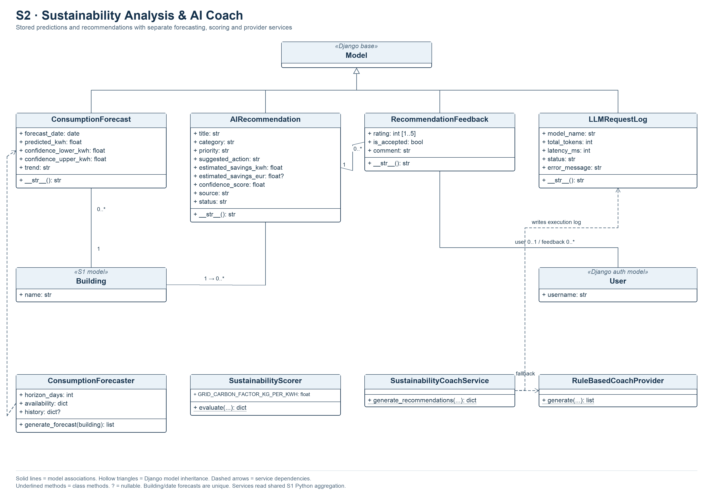

# S2 — Sustainability Analysis & AI Coach

## 1. Subsystem Overview

S2, owned by Syed Yasoob Raza, derives daily consumption forecasts, an illustrative
sustainability assessment and energy-saving recommendations from S1 observations.
It stores forecasts, recommendation records, provider execution logs and feedback.
Django models and REST APIs expose these features to Streamlit. Optional OpenAI
chat completions supplement a deterministic rule-based provider.

S2 depends on S1's `Building` and shared Python aggregation. Forecast and assessment
inputs use complete UTC days. S3 owns tariff-based currency calculations. The
shared account application supplies authenticated users for feedback.

## 2. Functional Requirements

| ID | Functional Requirement | Implementation | Verification |
|---|---|---|---|
| S2-FR-01 | The system shall determine forecast availability from at least two complete UTC days in the preceding 14 completed calendar days. | `ConsumptionForecaster.generate_forecast()` in `services/forecaster.py` | `EnergyIntegrationTests.test_s2_missing_ambiguous_unknown_and_partial_data_do_not_fall_back` |
| S2-FR-02 | The system shall calculate seven daily predictions beginning tomorrow with weekday/weekend factors and illustrative bands. | `ConsumptionForecaster` | `CoachAPITests.test_forecast_endpoint` |
| S2-FR-03 | The system shall store or update one forecast per building and forecast date. | `ConsumptionForecast`, `update_or_create()` | Forecast API tests and database `unique_together` declaration |
| S2-FR-04 | The system shall calculate an illustrative baseline-relative score, grade and carbon scenario from supplied daily observations. | `SustainabilityScorer.evaluate()` | `EnergyIntegrationTests.test_scorer_uses_supplied_import_estimate_and_never_daily_netting` |
| S2-FR-05 | Recommendation generation shall validate the building and a savings target between 1% and 50%. | `GenerateRecommendationInputSerializer`, `GenerateRecommendationsAPIView` | `CoachAPITests.test_recommendation_generate_endpoint`, serializer bounds |
| S2-FR-06 | The rule-based provider shall produce recommendations from eligible observed energy, solar generation and the requested savings target. | `RuleBasedCoachProvider.generate()` | Recommendation API and complete-zero-day integration tests |
| S2-FR-07 | The service shall attempt OpenAI recommendations for a configured eligible key and use rule-based results when no usable result is obtained during provider invocation. | `SustainabilityCoachService.generate_recommendations()` | `EnergyIntegrationTests.test_live_provider_payload_is_serializable_but_external_call_is_mocked` and no-key API tests. Malformed persistence output remains an open defect. |
| S2-FR-08 | Successful generation shall store recommendations and provider token, latency and status information. | `AIRecommendation`, `LLMRequestLog` | `CoachAPITests.test_recommendation_generate_endpoint` |
| S2-FR-09 | The API shall list stored recommendations with an optional building filter. | `RecommendationListView.get_queryset()` | `CoachAPITests.test_recommendation_list_and_building_filter` |
| S2-FR-10 | Feedback shall bind a 1–5 rating, acceptance flag and optional comment to the URL recommendation and authenticated user. | `RecommendationFeedbackSerializer`, `RecommendationFeedbackCreateView` | Feedback tests in `coach/tests.py` and `AccountsApiTests.test_authenticated_recommendation_feedback_binds_to_user` |

## 3. Non-Functional Requirements

| ID | Non-Functional Requirement | Implementation / Evidence |
|---|---|---|
| S2-NFR-01 | Measurement consistency shall use S1 gross main energy and complete-day inputs across forecasting and assessment. | Shared aggregation and `test_two_complete_days_forecast_uses_main_only_and_all_subsystems_agree`. |
| S2-NFR-02 | Missing-input handling shall return availability reasons and nullable predictions when sufficient observations are absent. | Empty `forecast`, HTTP 200 unavailable generation and `NOT_RUN` engine status. Integration tests check the response. |
| S2-NFR-03 | Data integrity shall keep each building/date forecast key unique. | Database uniqueness on `ConsumptionForecast`. |
| S2-NFR-04 | Domain access shall require authentication and attribute feedback to the current user. | Explicit `IsAuthenticated` and server-side `serializer.save(user=user)`. Object-level building ownership is outside the current schema. |
| S2-NFR-05 | Offline operation shall support recommendation generation with an empty OpenAI key. | `RuleBasedCoachProvider` and `BootstrapTests.test_s2_and_s3_ready_without_openai`. |
| S2-NFR-06 | Assessment explanations shall identify forecast bands, scores and the carbon factor as heuristic assumptions. | Model help text, forecaster availability metadata and scorer factor `0.385 kg/kWh`. Calibration has no verification evidence. |
| S2-NFR-07 | Currency consistency shall leave recommendation savings in EUR unavailable without a priced action scenario. | Service assigns `estimated_savings_eur=None`. Integration tests cover provider-supplied monetary guesses. |
| S2-NFR-08 | Test isolation shall allow external-provider responses to be mocked and database writes to use disposable PostgreSQL. | `coach/tests.py`, `test_energy_integration.py` and settings guards. |
| S2-NFR-09 | Maintainability shall separate forecasting, scoring and provider orchestration. | `forecaster.py`, `scorer.py`, `llm_coach.py`. Each has a distinct class responsibility. |
| S2-NFR-10 | Provider reliability shall validate complete output before persistence and bound response latency. | Design objective with identified gaps. Coach output lacks a full schema check and atomic multi-record persistence, and it uses SDK-default timeout/retry behavior. No latency benchmark is claimed. |

## 4. UML Class Diagram

The four stored entities inherit Django `Model`. Building and User are existing
external model dependencies. `LLMRequestLog` has no foreign key to a building or
recommendation. Provider collaboration uses method calls between existing classes.

## 5. Important Classes and Responsibilities

| Class | Responsibility | Important Methods |
|---|---|---|
| `ConsumptionForecast` | Building/date prediction, lower and upper bands, trend and creation time. | `__str__()`, inherited ORM methods |
| `AIRecommendation` | Title, category, priority, action, illustrative kWh savings, source and status. | `__str__()`, inherited ORM methods |
| `RecommendationFeedback` | Recommendation, nullable user, rating, acceptance and comment. | `__str__()`, inherited `full_clean()` |
| `LLMRequestLog` | Model, tokens, latency, execution status and error text. | `__str__()`, inherited ORM methods |
| `ConsumptionForecaster` | Obtain complete days, calculate and persist forecasts. | `__init__()`, `generate_forecast()` |
| `SustainabilityScorer` | Baseline comparison, score/grade, solar ratio and carbon estimate. | Class method `evaluate()` |
| `RuleBasedCoachProvider` | Deterministic peak, solar/lighting and behavioral recommendations. | Class method `generate()` |
| `SustainabilityCoachService` | Optional OpenAI invocation, fallback, logging and persistence. | Class method `generate_recommendations()` |

Django model and DRF view/serializer subclasses demonstrate framework inheritance.
S2 services use separate classes and class methods. The provider classes have no
shared ABC or inheritance relationship. No S2 domain operator overload or custom
iterator is implemented. Reuse of S1's strategy classes occurs through the shared
data pipeline.

## 6. Internal Architecture and Data Flow

### Forecast and assessment

`ConsumptionForecaster` bounds S1 aggregation from UTC midnight 14 days ago to
today's UTC midnight. It requires at least two complete days and available main
coverage. The arithmetic mean of complete-day gross totals supplies the base.
Predictions use factors 1.08 for weekdays and 0.72 for weekends. Baseline comparison
sets INCREASING above 110% of baseline and DECREASING below 90%, with a small
per-day drift and widening illustrative bands. Dates start tomorrow. Forecasts
are stored using `update_or_create()`.

The recommendation view also obtains an all-history S1 summary. Recent complete
main/solar days supply daily averages and matched interval import estimates.
Unavailable main history, fewer complete days or missing solar alignment return
an availability reason. Forecast calculation can already have written valid rows
before recommendation eligibility is refused.

`SustainabilityScorer` requires daily energy, daily solar and a positive baseline
for its score. It bounds the score to 0–100 and maps thresholds to grades A+ through
F. Daily carbon uses the supplied matched-import average multiplied by 0.385 kg/kWh.
Daily monetary cost is null. The solar offset ratio is unavailable for zero gross
energy. The score remains an illustrative baseline comparison.

### Recommendations and feedback

The rule provider evaluates the observed main peak, positive daily solar and a
weekly savings target. Peak-only and load-shifting rules retain zero kWh savings.
Lighting/standby and behavioral rules use explicit illustrative weekly fractions.
Recommendation monetary savings remain null.

A key beginning with `sk-` enables optional OpenAI invocation, with
`OPENAI_MODEL` defaulting to `gpt-4o-mini`. The request serializes building metadata,
the coach summary, three preview forecast entries and the target. The prompt asks
for a JSON array of recommendations. Invocation or parsing failures use the fallback.
Nonempty parsed arrays proceed to logging and row creation. Output validation and
partial-persistence weaknesses are recorded in the review.

`LLMRequestLog` records the selected provider status, tokens, latency and any error.
Recommendation rows start PENDING. Feedback stores the authenticated user and binds
to the recommendation URL. A conflicting body recommendation ID returns 400.
Feedback is stored for review. The current workflow has no model-training step or
automatic recommendation-status transition based on acceptance.

## 7. APIs and Subsystem Integration

All routes require authentication. The `/api/coach/` prefix exposes the same S2
route definitions as the shared `/api/` prefix.

| Route | Methods | Behavior |
|---|---|---|
| `/api/buildings/{id}/forecast/` | GET, POST | Recalculate and store seven forecasts, returning availability metadata. |
| `/api/recommendations/generate/` | POST | Validate inputs, assess observations and generate records when eligible. |
| `/api/recommendations/` | GET | Paginated stored records, optional integer `building_id`. |
| `/api/recommendations/{id}/feedback/` | POST | Store validated feedback bound to the URL and current user. |

Generation accepts `{"building_id":1,"target_savings_pct":15}`. A usable result
returns 201 with `energy_summary`, `forecast_availability`,
`sustainability_assessment`, `recommendations` and `engine_telemetry`. Insufficient
data returns 200, an empty recommendation list and `availability.available=false`.
Unknown buildings return 404 and invalid inputs return 400. Forecast GET requests
can persist data and update existing forecast values.

Feedback accepts `rating`, `is_accepted` and `comment`. The user field is read-only.
The frontend's Forecast and Recommendations pages call these APIs. S1 remains the
source of interval and coverage semantics. S2 supplies no Kafka consumer and uses
no direct HTTP call to S1's summary endpoint.

## 8. Validation and Testing

The input serializer bounds the savings target to 1–50%. Feedback validators accept
ratings 1–5. The serializer checks URL/body identity and the view attributes the
current user. Model field validators require `full_clean()` on direct ORM writes.
Feedback rating storage has no additional database range constraint.

`coach/tests.py` covers forecast availability, generation, stored recommendation
filters, invalid building filters, feedback binding/range and unauthenticated access.
`monitoring/test_energy_integration.py` checks main-only energy, complete zero days,
unknown duration, partial data, solar matching, scorer inputs and a mocked OpenAI
request. `monitoring/test_bootstrap_profiles.py` verifies fresh-history readiness
without an AI key. `accounts/tests.py` checks authenticated feedback attribution.
Frontend AppTest covers navigation and session behavior with mocked HTTP calls.
Current results and diagnostic probes appear in the submission review.

## 9. Technical Limitations

Forecast factors, bands, scores and carbon assumptions have no calibration study.
Stored forecasts are recalculated by their GET endpoint. Recommendation generation
has no idempotency key. Concurrent or retried requests may create repeated actions.
Provider output can contain invalid fields, and a later row failure can leave
partial records and a success log. Coach request timeout/retry behavior follows SDK
defaults. Feedback has no learning pipeline or evidence of realized savings.

Shared access permissions and the Streamlit session-cache issue affect all pages.
No per-building ownership is modeled. Provider error text is stored in execution
logs. The current numeric savings-target serializer also lacks an explicit finite
check. These issues require a separate implementation task.

The service implementations and models provide the primary code references.
[Forecaster](../../backend/coach/services/forecaster.py),
[scorer](../../backend/coach/services/scorer.py),
[coach providers](../../backend/coach/services/llm_coach.py),
[models](../../backend/coach/models.py),
[API views](../../backend/coach/views.py),
[submission review](../submission-review.md)
