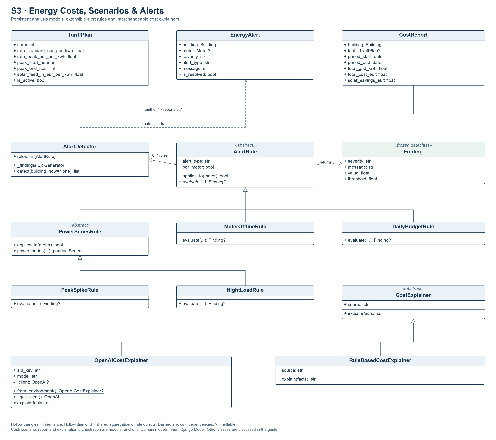

# S3 — Energy Costs, Scenarios & Alerts

## 1. Subsystem Overview

S3, owned by Marwan Ahmed, prices stored energy observations, evaluates what-if
scenarios, detects rule-based alerts, stores cost reports and explains cost figures.
It uses Django REST Framework, PostgreSQL, S1's shared aggregation, Python Decimal,
Pandas and NumPy. Optional OpenAI explanations have a template-based fallback.
Streamlit exposes Costs, Scenarios, Alerts and Reports pages.

S1 supplies gross energy, separate solar generation, interval alignment and coverage.
S3 uses one active global tariff for scenario pricing. S2 retains ownership of
consumption forecasts and sustainability recommendations.

## 2. Functional Requirements

| ID | Functional Requirement | Implementation | Verification |
|---|---|---|---|
| S3-FR-01 | Authenticated users shall create and update tariffs with finite nonnegative rates, valid UTC hours and sequential single-active-plan validation. | `TariffPlanSerializer`, tariff API views | `TariffValidationTests` |
| S3-FR-02 | Cost analysis shall estimate interval import charges, export credits and net cost using the active tariff and shared S1 data. | `cost_analysis()` in `services/costs.py` | `AnalysisAPITests`, `EnergyIntegrationTests` |
| S3-FR-03 | Scenario calculation shall re-price the same observations with consumption, solar or alternative-tariff changes. | `run_scenario()`, `_price()` | `ReportAndScenarioTests` |
| S3-FR-04 | Scenarios shall accept paired inclusive UTC dates or select the latest contiguous run of complete days when dates are omitted and complete days exist. | `ScenarioRequestSerializer`, `latest_complete_period()` | `ScenarioPeriodTests`, `test_scenario_custom_dates_are_sent` |
| S3-FR-05 | Alert detection shall evaluate peak spike, unusual night load, meter offline and complete-day budget rules. | `AlertRule` subclasses, `AlertDetector` | `AlertDetectionTests`, `AlertRuleDesignTests` |
| S3-FR-06 | Sequential detection shall skip an unresolved alert of the same building, meter and rule type. | `AlertDetector.detect()` | `test_meter_offline_and_duplicates_are_not_repeated` |
| S3-FR-07 | Users shall list/filter alerts and update their resolution state. | Alert API views and `EnergyAlertSerializer` | `test_alert_update_only_changes_resolution_and_list_filters`, frontend resolve test |
| S3-FR-08 | Report generation shall store a tariff-based cost report for fully covered inclusive UTC dates or return an unavailable reason. | `generate_cost_report()`, `BuildingCostReportView` | `ReportAndScenarioTests.test_report_is_generated_and_listed`, `test_report_is_refused_without_tariff_or_full_coverage` |
| S3-FR-09 | Users shall list stored reports and download the displayed report columns as CSV. | Report list APIs and frontend `reports()` | Backend report-list tests. CSV implementation inspected in source, with no dedicated download test. |
| S3-FR-10 | Cost explanations shall use OpenAI when configured and fall back to rule-based text after an expected explanation failure. | `CostExplainer` subclasses, `explain_costs()` | `ExplainCostsTests`, `ExplainerClassTests`, frontend explanation test |

## 3. Non-Functional Requirements

| ID | Non-Functional Requirement | Implementation / Evidence |
|---|---|---|
| S3-NFR-01 | Monetary arithmetic shall use Decimal and round summed amounts half-up to cents. | `costs.py`, `scenarios.py`, manually checkable report/scenario tests. |
| S3-NFR-02 | Measurement consistency shall derive consumption and grid estimates from shared S1 intervals. | `building_energy_report()` consumers and cross-subsystem integration tests. |
| S3-NFR-03 | Coverage reliability shall report unavailable prices for mismatched solar, unknown duration, overlap or tariff-band crossing. | Cost and scenario availability fields, alignment and interval-band tests. Stored-tariff validation differs between the two services and remains an open defect. |
| S3-NFR-04 | Domain access shall require authenticated requests. | Explicit `IsAuthenticated` on all analysis views and explanation authentication test. All authenticated users currently share data access. |
| S3-NFR-05 | Expected OpenAI failures shall permit an offline cost explanation for valid available facts. | `ExplanationUnavailable` handling and fallback tests. Unavailable measurement inputs still return an unavailable result. |
| S3-NFR-06 | OpenAI explanation requests shall use a 12-second client timeout with zero automatic retries. | `OpenAICostExplainer._get_client()`. This configures the SDK, while end-to-end latency has no benchmark. |
| S3-NFR-07 | Maintainability shall support injected alert-rule collections and cost-explainer clients. | ABC interfaces, overridden methods, `AlertDetector(rules=[])` and fake-client tests. |
| S3-NFR-08 | Testability shall support controlled rule clocks and provider mocks using disposable PostgreSQL. | `detect_alerts(...,now=...)`, injected clients, existing backend and AppTest suites. |
| S3-NFR-09 | Usability shall present named reason explanations and a visible provider source on the dashboard. | `REASONS`, alert guidance, `_cost_explanation()` and frontend tests. Current wording accuracy issues are recorded separately. |
| S3-NFR-10 | Concurrent integrity shall prevent competing active tariffs and duplicate unresolved alerts. | Design objective with an implementation gap. Sequential serializer/existence checks are present, while database constraints or atomic coordination for these invariants are absent. |

## 4. UML Class Diagram

Existing service functions are described below. The class diagram contains real
models, rule/explainer classes and exceptions. Nullable report tariffs and alert
meters have multiplicity `0..1`. The detector may accept an empty rule list or
externally supplied rule instances, represented by shared aggregation.

## 5. Important Classes and Responsibilities

| Class | Responsibility | Important Methods |
|---|---|---|
| `TariffPlan` | Standard/peak rates, UTC hours, export credit and active flag. | `__str__()` |
| `EnergyAlert` | Building, nullable meter, severity, type, observation, threshold and resolution. | `__str__()` |
| `CostReport` | Building, nullable tariff, dates, imported kWh, net cost and solar saving snapshot. | `__str__()` |
| `AlertRule` | Abstract rule interface and per-meter/per-building scope. | `applies_to()`, abstract `evaluate()` |
| `PowerSeriesRule` | Abstract main-meter power-series base. | `applies_to()`, static `power_series()` |
| `PeakSpikeRule`, `NightLoadRule` | Detect unusual main-meter sampled power. | `evaluate()` |
| `MeterOfflineRule`, `DailyBudgetRule` | Detect stale readings or complete-day baseline exceedance. | `evaluate()` |
| `Finding` | Frozen severity, message, value and threshold result. | Dataclass constructor |
| `AlertDetector` | Hold rules, yield evaluations and persist sequentially deduplicated alerts. | `__init__()`, `_findings()`, `detect()` |
| `CostExplainer` | Abstract plain-language explanation interface. | Abstract `explain()` |
| `OpenAICostExplainer` | Configure/inject an OpenAI client and produce explanation text. | `from_environment()`, `_get_client()`, `explain()` |
| `RuleBasedCostExplainer` | Format available cost facts into template text. | `explain()` |
| `AnalysisError` | Base expected analysis exception. | Inherited exception methods |
| `ReportUnavailable` | Expected report failure carrying a reason code. | `__init__()` |
| `ExplanationUnavailable` | Failure allowing the next explainer to run. | Inherited exception methods |

The two ABC hierarchies demonstrate abstraction, inheritance and method overriding.
`AlertDetector` invokes rules polymorphically, and `explain_costs()` invokes a list
of explainers through their common interface. The detector aggregates rule objects.
`Finding` encapsulates an immutable result. `_findings()` is a generator used by
actual detection. OpenAI client injection supports isolated tests. There is no S3
domain operator overload.

## 6. Internal Architecture and Data Flow

### Tariffs, costs and scenarios

`cost_analysis()` obtains S1's report and checks for exactly one active global
tariff. It checks finite nonnegative rates, hour bounds and distinct peak endpoints.
The active plan applies to the selected recorded history. Peak hours are half-open
UTC bands, including overnight bands. `_interval_rate()` rejects an interval crossing
unequal tariff bands. Flat prices can price those intervals directly.

For aligned intervals, import is `max(gross-solar,0)` and export is
`max(solar-gross,0)`. Import energy is priced at the standard/peak rate, export at
the feed-in rate. Currency totals use Decimal and cent rounding. Legacy
`gross_cost_eur`, `solar_savings_eur` and `net_cost_eur` require continuous main-span
coverage. The `estimated_*` fields can describe matched observations across gaps.
`solar_savings_eur` prices self-consumed generation at the import rate.
`complete_bill_available` is always false.

`run_scenario()` prices baseline and modified quantities on the same grid intervals.
Consumption and solar percentages scale their respective interval energy. An
alternative tariff is an unsaved `TariffPlan` instance. Paired inclusive dates map
to UTC midnight through midnight after the end date. Without dates,
`latest_complete_period()` chooses the newest contiguous run of complete main days.
When no complete day exists, the original all-history scope is used. The response
includes selected dates and `period_auto` when a date scope exists. Main coverage
and solar matching still govern availability. Stored-tariff validity checks are
less complete here than in `cost_analysis()`.

### Alerts and reports

Detection is an explicit API action. Each active meter is considered for applicable
rules. Main power rules load the preceding 24-hour series into Pandas and use NumPy
means. PeakSpikeRule needs more than ten samples and compares the latest sample
with twice the preceding-sample mean. NightLoadRule needs ten samples in each group
and compares 00:00–04:59 UTC mean with 50% of other-hour mean. Sampling weights are
per record.

MeterOfflineRule considers the latest reading's timestamp plus known duration and
triggers after 15 minutes. A meter with no readings yields no finding. DailyBudgetRule
uses the most recent complete gross-energy day and a positive building baseline,
which may be older than yesterday. Detection skips an already unresolved matching
alert in sequential execution. Resolving an alert permits a later new finding.

Reports require inclusive dates, available prices and full main coverage. A successful
request stores a `CostReport` with the current tariff reference, imported energy,
net cost and self-consumed solar savings. Report listing and CSV download read stored
values. Concurrent tariff changes and repeated report requests have no transactional
snapshot or idempotency guarantee.

### Plain-language explanations

`build_cost_facts()` combines all-history costs with the potential saving from a
10% consumption scenario. `explain_costs()` tries injected or default explainers
in order. `OpenAICostExplainer` uses a key starting with `sk-`, the configured model,
a 12-second SDK timeout and zero retries. Empty or failed responses raise
`ExplanationUnavailable` and lead to template text. The HTTP response removes the
internal `facts` field and identifies `source` and any `fallback_reason`.

Cost explanations are generated responses with no dedicated persistence model.
Their current paid-cost wording and elapsed-span daily average can overstate what
incomplete observations establish. S2's separate request log covers the coach path.

## 7. APIs and Subsystem Integration

Authentication is required. `/api/analysis/` provides the same analysis routes.

| Route | Methods | Behavior |
|---|---|---|
| `/api/tariffs/`, `/api/tariffs/{id}/` | GET, POST / GET, PUT, PATCH | Manage global price plans. |
| `/api/buildings/{id}/cost/` | GET | All-history interval cost estimates and coverage metadata. |
| `/api/buildings/{id}/cost/explain/` | POST | Available explanation text and provider identity. |
| `/api/buildings/{id}/scenarios/` | POST | Same-period baseline and modified costs. |
| `/api/alerts/`, `/api/alerts/detect/`, `/api/alerts/{id}/` | GET / POST / GET, PUT, PATCH | Filter, detect and resolve alerts. |
| `/api/buildings/{id}/reports/`, `/api/reports/` | GET, POST / GET | Generate and list stored reports. |

Scenario percentages default to zero and have bounds -100 through 1000. Date fields
are optional together. Invalid scenario input returns 400. Unavailable calculations
return 200 with `available=false`, a reason and null prices. Reports require both
dates and return 201 after storage, 400 for malformed date input or 422 for expected
coverage/tariff failures. Alerts expose optional building, resolution, severity and
type filters. Only `is_resolved` is writable in alert updates.

Streamlit automatically recalculates a scenario as its controls change. The UI can
switch tariffs through several HTTP requests, resolve alerts and export report
columns as CSV. S1 remains the measurement source and S2 supplies separate energy
forecasts. S3 has no Kafka consumer.

## 8. Validation and Testing

Tariff serializers check finite nonnegative prices, UTC hour bounds, distinct peak
hours and sequential active-plan conflicts. Scenario serializers validate finite
percentages, paired ordered dates and a representable next day. Report serializers
validate date parsing, while service ordering/coverage failures use
`ReportUnavailable`. The maximum representable report end date currently causes an
unhandled overflow. Malformed integer list filters can also fail with HTTP 500.

`analysis/tests.py` covers tariffs, detection/resolution, report storage and manually
verifiable scenario prices. `test_scenario_periods.py` covers explicit and automatic
periods, live gaps, matching solar and incomplete coverage. `test_explainer.py`
covers abstract interfaces, injected OpenAI responses, fallback and authentication.
S1's `test_energy_integration.py` checks shared pricing and measurement semantics.
Frontend AppTest covers tariff entry/switching, scenario controls, displayed results,
explanation source and alert resolution. The preserved S3 report records an earlier
41-backend/22-dashboard run. The current review records a fresh execution.

## 9. Technical Limitations

Pricing applies one global tariff across history. Per-building contracts, historical
rates, taxes, fees and batteries have no implementation. Export/import values are
interval estimates. Alert detection has no background schedule, uses sample-weighted
power means and performs sequential deduplication. Concurrent tariffs and detections
can violate intended invariants. Daily averages in cost explanations and the UI use
elapsed timestamp span, even across gaps.

The template can describe solar as mostly self-consumed without testing that claim.
Provider text is accepted without independent numeric fact checking. Shared account
permissions, predictable demo credentials and dashboard session sharing affect S3.
These issues are reported for follow-up with application behavior preserved.

The primary implementation is in analysis services, models and views.
[Services](../../backend/analysis/services/), [models](../../backend/analysis/models.py),
[views](../../backend/analysis/views.py), [submission review](../submission-review.md)
